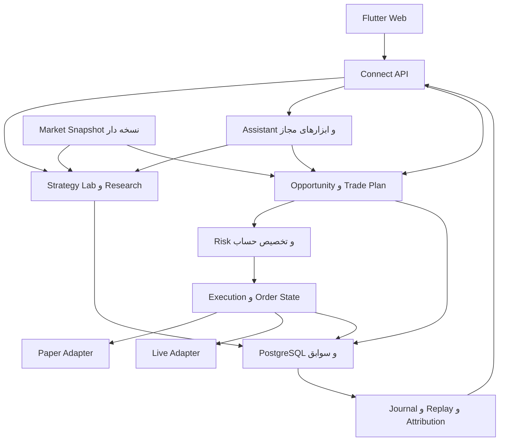
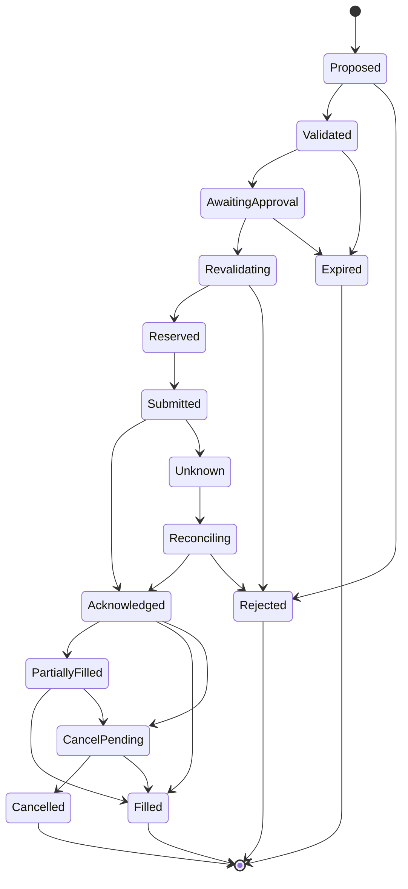

# پلن جامع توسعه پلتفرم پژوهش و معامله هوشمند

نسخه ۲٫۰ | تاریخ ۱ نوامبر ۲۰۲۶ | وضعیت سند: پیشنهاد اجرایی برای طراحی و توسعه

**هدف:** توسعهٔ Trading Research Lab به پلتفرمی برای کشف و ساخت استراتژی، ارزیابی مستقل، پیشنهاد معامله با کمک AI، معاملهٔ مجازی، مدیریت ریسک و سپس اجرای واقعی اسپات و قراردادهای اهرم‌دار. ارزش محصول با کیفیت تصمیم و نتیجهٔ خالص قابل ردیابی سنجیده می‌شود؛ سودآوری آینده یک معیار قابل آزمون است، نه فرض تضمین‌شدهٔ برنامه.

**تصمیم معماری:** توسعهٔ تدریجی روی Flutter Web و موتور Go فعلی، با PostgreSQL، Connect/Protobuf و کامپوننت‌های موجود. بازنویسی کامل، تبدیل به میکروسرویس، مهاجرت به React یا افزودن Python به مسیر اصلی الزامی نیست. رابط کاربری و کیفیت تجربه، خروجی مستقل هر فازند و به پایان پروژه موکول نمی‌شوند.

**مبنای فنی:** شاخه main در مخزن TheNightDeveloper/trader-lab با commit `8f17e4574bda698c44798643b60826bd35fcfba7`. در شروع نگارش، head همچنان همین نسخه بود. گزارش فنی قبلی، PRD فارسی ۱٫۲، brief طراحی ۱٫۱، اسناد داخل مخزن و تصمیم‌های این گفتگو ورودی‌های سند هستند. هرجا میان سند قدیمی و کد اختلاف وجود دارد، بخش «وضعیت موجود» از کد گرفته شده و رفتار آینده صریحاً به‌عنوان پیشنهاد آمده است.

این سند یک پلن است؛ قابلیت‌های پیشنهادی هنوز در مخزن پیاده نشده‌اند. اجرای کامل Go/Flutter، تست DB و race در بررسی قبلی به‌دلیل نبود toolchain تأیید نشده بود. فاز P0 این فاصلهٔ شواهد را می‌بندد. شناسه‌های P0 تا P8 در این سند **فازهای جدید** هستند و با milestoneهای M0 تا M6 نسخهٔ قبلی تفاوت دارند.

**وضعیت اجرا — ۲۰۲۶/۱۱/۰۳:** FIX-04 و FIX-05، بخش‌هایی از F07، محدودیت پژوهش F08، منشأ و بازتولید F13 و کنترل مشترک lifecycle در F15 پیاده شده‌اند. بستهٔ تازهٔ F07 لغو را تا ساخت نمونه، scaler و ridge/logistic می‌برد؛ fit ورودی محدود دارد و مهلت محافظه‌کارانهٔ آموزش تا freeze اعمال می‌شود. اجرای مستقل Go با ۳۱۹ تست و دیتابیس اجباری، بدون شکست یا skip، و ۵۴ تست Flutter پاس شد؛ ۱۱ golden بدون تغییرند. تضمین RAM/CPU کل فرایند، race و gate کل P0 بازند. admission مشترک حافظهٔ فعال با تنظیم سروری اضافه شد؛ ادامه با محدودیت import و پذیرش بار/RSS در F07 است. دامنه و سازگاری در [وضعیت P0](P0_STATUS.md).

## فهرست راهنما

۱. مسیر محصول و تصمیم‌های دامنه  
۲. معماری فعلی و موارد قابل استفادهٔ مجدد  
۳. اصلاحات نسخهٔ موجود  
۴. معماری هدف و مرز مسئولیت‌ها  
۵. قابلیت‌های محصول و قرارداد رفتار  
۶. طراحی فرانت و تجربهٔ کاربری  
۷. فازهای توسعه و معیار پایان  
۸. داده، API، مهاجرت و سازگاری  
۹. کیفیت، سنجش، عملیات و هزینه  
۱۰. ترتیب شروع توسعه و نقشهٔ پوشش قابلیت‌ها  
۱۱. تصمیم‌های باز و منابع

## ۱ مسیر محصول و تصمیم‌های دامنه

### ۱٫۱ تجربهٔ نهایی

کاربر می‌تواند استراتژی شناخته‌شده‌ای را پیدا کند یا ایدهٔ خودش را با فرم یا زبان طبیعی تعریف کند؛ آن را روی دادهٔ نسخه‌دار با فرض‌های روشن آزمایش کند؛ نسخهٔ مناسب را در حساب مجازی قرار دهد؛ فرصت‌های دارای ورود، TP، SL، حجم و شرط ابطال ببیند؛ نتیجهٔ پیشنهاد و تصمیم خود را پیگیری کند؛ و پس از عبور از دروازه‌های انتشار، اجرای واقعی را فعال کند.

پژوهش همچنان مبنای انتخاب و بهبود الگوریتم‌هاست. صفحهٔ اصلی محصول به کار روزانه، موقعیت‌های باز، فرصت‌ها و اقدام بعدی اختصاص می‌یابد. دستیار AI در متن همین کارها قرار می‌گیرد و صفحهٔ چت تمام‌صفحه جای صفحات اصلی را نمی‌گیرد.

### ۱٫۲ ترتیب انتشار

| خروجی | فازها | چیزی که واقعاً قابل استفاده می‌شود |
|---|---|---|
| پایهٔ قابل اتکا | P0 و P1 | اصلاح صحت موتور، طراحی مشترک، قرارداد داده و جریان‌های اصلی |
| آزمایش و استراتژی قابل توسعه | P2 | کتابخانه، استراتژی کاستوم و ترکیب‌های ساده با ارزیابی مستقل |
| نسخهٔ کاربردی معاملات مجازی | P3 و P4 | فرصت‌های زنده، برنامهٔ معامله، حساب مجازی، ژورنال و دستیار AI با مقایسهٔ سایه |
| معاملات اهرم‌دار مجازی | P5 | Long/Short روی قرارداد USDT خطی با مارجین و Funding |
| اجرای واقعی اسپات | P6 | یک آداپتور صرافی، ابتدا با تأیید هر معامله |
| اجرای واقعی قرارداد و ترکیب پیشرفته | P7 | اهرم‌دار پس از تأیید آداپتور؛ تخصیص و ترکیب پیشرفته |
| گسترش منابع و یادگیری | P8 | رادار رویداد، احساسات، جستجوی ساختاری گسترده‌تر و افزونهٔ کاستوم |

P5 و P6 پس از آماده‌شدن زیرساخت مشترک P3/P4 دو شاخه‌اند؛ آزمون مجازی اهرم‌دار پیش‌نیاز اجباری انتشار اسپات واقعی نیست. P7 اجرای واقعی قرارداد به P5 و زیرساخت اجرای P6 نیاز دارد. جریان تأیید و مدت مشاهدهٔ forward قابل حذف با آماده‌شدن کد نیست.

### ۱٫۳ دامنهٔ اولیه و موارد موکول‌شده

- ابتدا یک کاربر، یک workspace و یک موتور محلی؛ ساختار account و environment از ابتدا صریح باشد.
- Flutter Web دسکتاپ‌محور با استفادهٔ خوانا روی موبایل؛ خروجی native Android/iOS پروژهٔ جداگانهٔ بعدی است.
- اسپات اولیه فقط جفت‌های USDT؛ ETHBTC تا تکمیل موجودی quote و دادهٔ نرخ متقاطع انتخاب اجرایی ندارد.
- قرارداد اولیه: USDT-margined linear perpetual، Isolated، One-way و یک venue. Cross، Hedge، قرارداد معکوس، اسپات با قرض و Portfolio Margin در انتشار اول اهرم‌دار نیستند.
- اجرای حقیقی با حساب و آداپتور پشتیبانی‌شدهٔ کاربر تعیین می‌شود. استفاده از مستندات Binance/Bybit در این سند انتخاب یا تأیید دسترس‌پذیری آن صرافی برای کاربر نیست.
- اشتراک‌فروشی، چندمستاجری، marketplace عمومی استراتژی و کپی‌ترید اجتماعی جزو این پلن اجرایی اولیه نیستند؛ هدف فعلی استفادهٔ معاملاتی و اندازه‌گیری مزیت است.

## ۲ معماری فعلی و استفادهٔ مجدد

| لایه | واقعیت فعلی در کد | تصمیم توسعه |
|---|---|---|
| بک‌اند | یک Go binary، Echo v5، Connect API و کارهای پس‌زمینه | حفظ modular monolith؛ مرز packageها قوی‌تر شود |
| دیتابیس | PostgreSQL، pgx، sqlc و goose؛ migration خودکار | migrationهای افزایشی و ثبت وضعیت سازگاری |
| حسابداری | money.Amount/Price/Qty، fixed-point و rounding صریح | استفاده برای همهٔ دفترها؛ افزودن مارجین، Funding و رزرو |
| پژوهش | data، sim، eval، metrics، report، search، experiment | حفظ و توسعهٔ نسخه‌دار؛ خروجی اجرای عملیاتی از آن جدا باشد |
| یادگیری | feature، model/train، ridge/logistic و loop با تأیید ارتقا | ارتقای bounded recipe و ارزیابی به‌ازای بازار/نسخه |
| فرانت | Flutter Web، Riverpod، go_router، decimal و localization فارسی | حفظ stack و شکستن تدریجی screenهای بزرگ به widgets/controllers |
| ظاهر | tokens تیره، Vazirmatn، JetBrains Mono، RTL | تم تیره فعلی مبنای تحویل؛ semantic tokens برای روشن در آینده |
| نمودار | KLineChart vendored پشت adapter؛ اندیکاتور از موتور | حفظ adapter؛ اضافه‌کردن لایه‌های trade plan، order، fill و mark |
| قرارداد | proto/lab/v1 منبع Go/Dart generated | توسعهٔ سازگار؛ فیلدهای قدیمی بازتفسیر نشوند |
| عملیات | limiter، backup، restore drill، scripts/ci.sh | تکمیل admission، CI واقعی، health عملیاتی و بازیابی حساب |

فایل‌های اصلی فرانت: `app/lib/app/router.dart`، `app/lib/app/nav.dart`، `app/lib/shell/`، `app/lib/core/api/engine.dart`، `app/lib/core/theme/tokens.dart`، `app/lib/core/widgets/` و `app/lib/features/`. فایل‌های generated در `app/lib/gen/` دستی ویرایش نمی‌شوند.

فایل‌های اصلی بک‌اند: `engine/cmd/engine/main.go`، `engine/internal/api/`، packageهای دامنه، `engine/internal/store/queries/`، `engine/migrations/` و `proto/lab/v1/`. queryهای sqlc در source SQL تغییر می‌کنند، نه در فایل generated.

### ۲٫۱ حل اختلاف با اسناد قبلی

| اختلاف | تصمیم این پلن |
|---|---|
| brief اولیه تم روشن و کد فعلی تم تیره دارد | حفظ تم و اجزای فعلی؛ اصلاح خوانایی/تراکم در P1؛ تم روشن بعد از تثبیت |
| README تا M3 را ساخته‌شده می‌داند | README با کد M6 و وضعیت تست واقعی همگام شود |
| spot-only و no-real-order در v1 | همچنان invariant مسیر پژوهش و اسپات قدیمی باقی بماند؛ مشتقات و اجرای واقعی قراردادهای مستقل و ADR تازه دارند |
| forward موجود حساب کاغذی کامل نیست | forward مدل حفظ شود؛ paper account با order lifecycle و ledger جدا افزوده شود |
| AI در سند قدیمی قابلیت بعدی بود | این پلن آن را پس از پایهٔ ریسک و معاملهٔ مجازی، در P4 وارد محصول می‌کند |
| قواعد و مدل‌ها محدودند | تعریف قابل ترکیب و کاستوم در P2، جستجوی ساختاری وسیع‌تر در P8 |

## ۳ اصلاحات نسخهٔ موجود

یافته‌های F01 تا F16 به گزارش بررسی فنی ارجاع دارند. P0 ابتدا با تست native، دامنهٔ دقیق هر یافته را بازتولید و ثبت می‌کند؛ این جدول به‌معنی اجرای قبلی همهٔ تست‌ها نیست.

| شناسه | کار اجرایی | محل اصلی | فاز و شاهد پایان |
|---|---|---|---|
| F01 | تعریف صریح decision/eligibility/fill time؛ حذف fill پیش از تصمیم؛ ثبت فرض مدل قیمت | sim/sim.go و golden | P0؛ delay صفر/۲ثانیه/چندکندلی و backfill؛ هیچ signal fill پیش از تصمیم |
| F02 | تفکیک warm-up اندیکاتور از تغییر وضعیت معاملاتی buy-and-hold | eval/gated و strategy/baselines | P0؛ خرید واقعی در OOS و holdout؛ benchmark جدا حفظ شود |
| F03 | جایگزینی AcquireAll غیراتمی با admission وزنی اتمی و سیاست fairness | jobs/limiter و مصرف‌کننده‌ها | P0؛ دو گزارش هم‌زمان بدون deadlock؛ لغو بدون نشت ظرفیت |
| F04 | ثبت training_cutoff، model_created_at، frozen_at و trade_start جدا؛ کنترل پوشش forward | loop/cycle و forward | P0؛ ساعت در train جلو برود؛ هیچ امتیازدهی پیش از freeze واقعی |
| F05 | period_pnl و cohort_lifetime_pnl جدا؛ wins با متریک هم‌دوره | eval/window و loop/gate | P0؛ خروج آینده، سود دورهٔ بسته‌شده را تغییر ندهد؛ ADR-017 به‌روزرسانی شود |
| F06 | terminal کردن candidateهای ناتمام همراه بستن چرخه در transaction | loop و learning.sql | P0؛ پس از kill/cancel/split failure هیچ queued در cycle نهایی |
| F07 | عبور Reproduce و forward از admission؛ بودجه CPU/حافظه و حد ورودی پیش از allocation | jobs، report، loop و strategy | P0/P1؛ هیچ مسیر سنگین خارج از سقف؛ محدودیت period و dataset size |
| F08 | حذف انتخاب اجرایی non-USDT از scope اولیه؛ مسیر کامل FX با holdings بعداً | API، search و picker | P0؛ پیام روشن capability؛ P8 فقط با تست حسابداری متقاطع |
| F09 | مارکر خروج از fill.RefPrice/Price همان رخداد، نه جمع ExitRef | api/chart | P0؛ qty غیر۱ و partial exit روی قیمت درست |
| F10 | invalidation انتخاب‌گر مشترک بعد از import و picker با server paging/search | report/data providers | P0؛ dataset تازه و ردیف ۲۰۱ قابل انتخاب |
| F11 | generation ID، cancellation و mounted check برای درخواست‌های محاسبه | pnl_screen و async controllers | P0؛ پاسخ قدیمی نتیجهٔ جدید را نپوشاند؛ dispose بی‌خطا |
| F12 | workflow واقعی با PostgreSQL، REQUIRE_DB=1، race، Flutter و generated check | CI و storetest | P0؛ قطع DB job اصلی را fail کند؛ passed/skipped جدا گزارش شوند |
| F13 | provenance شامل commit/build/instrument/data/policy؛ مقایسه canonical معاملات و اعداد دقیق | report و versioning | P0/P1؛ fills متفاوت با PnL برابر، identical اعلام نشوند |
| F14 | برابری فرض‌ها بر مقادیر canonical، مستقل از rounding نمایشی | eval/compare | P0؛ اختلاف۱ppm هزینه و timestamp داخل روز شناسایی شود |
| F15 | سرویس مشترک تغییر version/model فعال با lock سطح algorithm و optimistic version | library و loop/promote | P0؛ approve/stop/switch/rollback زوج ناسازگار ندهد |
| F16 | یکدست‌کردن README، PROGRESS، METRICS، UI_SPEC و شواهد release | docs | P0 و هر فاز؛ مشخص باشد چه چیزی ساخته، اجرا و تأیید شده |

### ۳٫۱ بررسی‌های تکمیلی اجباری در P0

۱. دادهٔ دیررس: History فقط بارهای واقعاً AvailableAt<=virtualNow را برگرداند؛ prefix مبتنی بر index برای availability نامرتب کافی نیست. resample زمان availability را از همهٔ اعضای مؤثر و بسته‌شدن bucket بسازد. اصلاح گذشته به‌صورت revision جدا بماند.

۲. snapshot دیتاست: آزمون ingest transaction که پیش از cutoff شروع و بعد از snapshot commit می‌شود. برای نسخه‌های تازه، عضویت صریح revisionهای کندل در `dataset_members` یا chunkهای content-addressed ثابت ثبت شود؛ repeatable-read به‌تنهایی نسخهٔ دائمی قابل بارگذاری در آینده نمی‌سازد. انتخاب اجرایی اولیه، manifest عضویت revisionها و hash canonical است؛ format_version مسیر legacy را جدا می‌کند.

۳. رقابت claim/cancel: ثبت claim و مالکیت job، بازخوانی وضعیت پس از claim، terminal شدن orphanها و recovery آزمایش cancelled تست شود. تضمین exactly-once محاسبه ادعا نشود؛ اثر ذخیره‌شده idempotent باشد و تلاش مجدد قابل مشاهده بماند.

۴. شبکه: timeout مستقل درخواست، retry با backoff و jitter برای خطاهای قابل تکرار، rate-limit و سلامت به‌ازای نماد؛ یک feed معطل نباید همهٔ نمادها را قفل کند.

۵. حسابداری مرزی: جمع‌های int64 بیرون money نیز overflow کنترل‌شده داشته باشند؛ fees، balances، notional و aggregate metric تست property و مرزی داشته باشند. قیمت/مقدار/واحد به‌صورت typeدار حمل شود.

۶. hash تست‌های قبلی تغییر کور نکند. تغییر معنای اجرای F01 یا متریک F05 نسخهٔ موتور/قرارداد ارزیابی تازه، ADR و راهنمای بازتولید می‌خواهد؛ گزارش تاریخی immutable می‌ماند و با برچسب legacy نمایش داده می‌شود.

## ۴ معماری هدف و مرز مسئولیت‌ها

### ۴٫۱ معماری در یک نگاه

این تقسیم‌بندی package و قرارداد است، نه الزام سرویس شبکه‌ای جدا. هسته یک binary می‌ماند. worker کد خارجی در P8 در صورت نیاز process جداست. Redis، Kafka، vector database و Kubernetes پیش‌نیاز این مسیر نیستند.

### ۴٫۲ چهار حالت اجرا

| حالت | هدف | قاعدهٔ حساب و اقدام |
|---|---|---|
| Research | بک‌تست، آموزش و جستجو | حساب واقعی و کلید ندارد؛ تصمیم تاریخی با virtual time |
| Paper | معاملات مجازی با دادهٔ زنده | ledger و موجودی مجازی مستقل، فرض fill ثبت‌شده |
| Shadow | مقایسهٔ policy یا نسخه‌ها در دادهٔ آینده | حساب‌های paper مجزا با بودجه، universe و زمان شروع ازپیش‌ثبت‌شده |
| Live | سفارش واقعی | account مشخص، مجوز اجرا، اعتبارسنجی تازه و تطبیق صرافی |

environment و account_id بخشی از همهٔ شناسه‌ها، cacheهای مجاز و mutationها هستند؛ یک boolean فرانت مرز ایمنی نیست. حالت در header، لیست و صفحهٔ سفارش دیده می‌شود. `RunMode_RESEARCH` فعلی دوباره معنا نمی‌شود؛ نوع جدید ExecutionEnvironment در proto افزوده می‌شود.

### ۴٫۳ packageهای پیشنهادی

| package | مسئولیت | وابستگی و ممنوعیت مهم |
|---|---|---|
| data و instrument | دادهٔ تاریخی/زنده، نسخه و قواعد instrument | افزودن venue/product/contract identity؛ legacy adapter حفظ شود |
| signal و strategy/definition | DTO مشترک، AST قواعد، validation و interpreter | بدون کلید صرافی، شبکه و اجرای مستقیم؛ strategy فعلی پشت adapter |
| strategy/composite | ترکیب و رفع تعارض | اجزای pinned و ترتیب deterministic؛ بدون میانگین کور TP/SL |
| market | watchlist، snapshot، regime و کیفیت | snapshot timestamp و freshness؛ مشتقات سری مستقل |
| opportunity و tradeplan | lifecycle فرصت و سناریوی ورود/خروج | داده و نسخه‌های ثابت؛ plan هر تغییر revision تازه |
| portfolio | ledger، موجودی آزاد/رزرو، موقعیت و snapshot حساب | منبع حقیقت حساب داخلی؛ reconciliation با venue |
| risk | بودجه زیان، exposure، سیاست رفتاری و leverage eligibility | تصمیم deterministic از snapshot؛ AI حق دورزدن آن ندارد |
| execution | order lifecycle، idempotency، تأیید و outbox | serial تصمیم به‌ازای حساب؛ ارسال فقط پس از risk check تازه |
| broker | interface و adapterهای read/paper/live | capability matrix و contract tests؛ secret فقط این مرز |
| assistant | orchestration مدل، tool calls، توضیح و proposal | import مستقیم live broker ممنوع؛ خروجی سفارش قابل ارسال نیست |
| journal و attribution | وقایع تصمیم، مداخله کاربر، replay و مقایسه | شواهد ثبت‌شده؛ روایت AI جای event واقعی را نگیرد |
| events و sentiment | خبر، تقویم، timestamp و شاخص‌ها | محتوای بیرونی دادهٔ غیرقابل اعتماد؛ بدون authority اجرای ابزار |
| sim و sim/derivatives | replay تاریخی و مدل قرارداد | pure/domain-only؛ هرگز search/loop/train/assistant/broker live را import نکند |

برای shared DTO از packageهای کوچک استفاده شود تا دور import ساخته نشود. depguard علاوه بر import مستقیم، مسیرهای حساس و composition root را بررسی کند. مدل آموزش‌دیده فقط artifact مصرف می‌کند و training را از داخل OnBar فراخوانی نمی‌کند.

### ۴٫۴ قرارداد زمانی و ثبت تصمیم

برای داده و تصمیم این زمان‌ها جدا نگهداری شوند: `event_at`، `published_at` در صورت وجود، `received_at`، `available_at`، `snapshot_at`، `decision_at`، `submitted_at` و `filled_at`. زمان ذخیره UTC است؛ نمایش پیش‌فرض Asia/Tehran با timezone آشکار. بار تایم‌فریم بالاتر فقط پس از بسته‌شدن و دریافت معتبر وارد تحلیل می‌شود.

هر تصمیم به snapshot، strategy version، model artifact، policy version، instrument-spec version، build و input digest متصل است. AI نیز prompt template، model identifier، tools، usage و خروجی پذیرفته‌شده را ثبت می‌کند؛ بازپخش deterministic نتیجهٔ ثبت‌شده را مصرف می‌کند و برای بازتولید گذشته مدل زبانی را دوباره صدا نمی‌زند.

### ۴٫۵ مسیر ورود تا ارسال

signal → candidate opportunity → validated trade plan → paper/approval → risk authorization تازه → account reservation و command ثبت‌شده → ارسال adapter → acknowledgment/unknown → fill/reconciliation → position و journal.

تأیید کاربر به hash همان plan، account، environment، policy version و محدودهٔ تغییر قیمت مجاز متصل است. تغییر مؤثر ورودی، اهرم، حجم یا SL تأیید قبلی را نامعتبر می‌کند. فاصلهٔ submit با validate محدود است؛ stale authorization اجرا نمی‌شود. رزرو سرمایه و تشخیص duplicate به‌ازای حساب transaction و serialization دارند تا دو تب یا دو استراتژی سرمایهٔ واحد را دوبار خرج نکنند.

در اجرای واقعی، exactly-once روی شبکه ادعا نمی‌شود. client_order_id پایدار، transactional outbox و lookup صرافی برای unknown outcome الزامی‌اند. timeout پس از ارسال باعث retry کور یا سفارش دوم نمی‌شود. لایهٔ journal/event رکورد افزایشی دارد، اما نیازی به بازنویسی کل دیتابیس به event sourcing نیست؛ snapshotهای query-friendly کنار eventها باقی می‌مانند.

این نمودار مسیر نمونهٔ سفارش ورود است؛ protection/exit سفارش‌های وابسته با state مستقل‌اند. رقابت cancel/fill و partial fill، موجودی و پوشش خروج را از رخداد واقعی تعیین می‌کند، نه از آخرین دکمهٔ زده‌شده.

## ۵ قابلیت‌های محصول و قرارداد رفتار

### ۵٫۱ فرصت و برنامهٔ معامله

خروجی روزمره یک Trade Plan نسخه‌دار است. فرصت ممکن است «در انتظار تأیید شرط»، «قابل بررسی»، «ردشده»، «منقضی» یا «نامناسب برای ورود با قیمت فعلی» باشد. هر استراتژی باید وضعیت بدهد، اما تولید پیشنهاد معامله برای همهٔ نمادها اجباری نیست. کمبود داده و نبود setup خروجی معتبرند.

| گروه | دادهٔ لازم در plan |
|---|---|
| هویت | plan/revision، snapshot، venue، instrument، product و جهت |
| منطق | strategy/composite version، اجزای مشارکت‌کننده، مدل و قواعد فعال‌شده |
| ورود | نوع سفارش، قیمت/محدوده، trigger قابل محاسبه، حداکثر انحراف مجاز |
| خروج | SL، مبنای trigger قیمت، اهداف TP و درصد هر خروج، time stop و trailing policy |
| اندازه | quantity، notional، مارجین در صورت نیاز، planned loss و محدودیت account |
| هزینه | fee، spread/slippage تخمینی، Funding تخمینی با سناریو/عدم قطعیت |
| اعتبار | زمان ارزیابی، TTL زمانی و شرطی، invalidation و minimum data coverage |
| شواهد | شاخص‌ها، وضعیت بازار، آمار OOS/forward مرتبط و محدودیت نمونه |
| تصمیم | eligible/rejected، دلیل machine-readable و متن فارسی موتور؛ شرح AI جدا |

TTL با هر توضیح تازهٔ AI تمدید نمی‌شود. revalidation با بازار و حساب تازه انجام می‌شود. سیگنال‌های هم‌نماد با fingerprint و بازهٔ زمانی مشخص deduplicate می‌شوند؛ چند strategy موافق، سفارش مستقلِ تکراری نمی‌سازند. اولویت فرصت از معیارهای شفاف مثل eligibility، هزینه، عملکرد معتبر و تازگی می‌آید؛ درصد اطمینان مدل زبانی به‌عنوان احتمال برد نمایش داده نمی‌شود. score رتبه‌بندی نیز با احتمال calibrated متفاوت برچسب می‌خورد.

### ۵٫۲ کتابخانه و استراتژی کاستوم

تعریف استراتژی شامل universe، instrument capability، تایم‌فریم‌ها، warm-up، featureهای مجاز، regime filter، ورود، خروج، sizing، رفتار پس از stop، نیاز داده و بودجهٔ محاسبات است. strategy instance قابل ویرایش draft دارد؛ نسخهٔ استفاده‌شده در run، paper یا live immutable است. lineage شامل parent، diff و علت تغییر ذخیره می‌شود.

سه مسیر ساخت:

۱. فرم بدون کد با بلوک‌های typed: comparison، cross، rolling، AND/OR، session/زمان و entry/exit. AST JSON نسخه‌دار با محدودیت عمق، lookback، چرخه و منابع، schema validation و canonical hash. تاریخچهٔ آینده، تابع شبکه و کد آزاد در DSL وجود ندارد.

۲. زبان طبیعی → پیش‌نویس AST: AI ابهام‌هایی مثل «روند قوی»، «پولبک» یا «کف معتبر» را به سؤال‌های دقیق و پارامتر تبدیل می‌کند؛ قواعد استخراج‌شده و دادهٔ لازم پیش از ذخیره قابل بررسی‌اند. خروجی از همان validator و interpreter عبور می‌کند. تا ابهام بحرانی رفع نشده، وضعیت draft/needs_definition باقی می‌ماند.

۳. کد اختصاصی در P8: worker جدا با قرارداد ورودی/خروجی نسخه‌دار، سقف CPU/RAM/time و شبکهٔ بسته. کلید صرافی و mutate account در اختیار کد نیست. قرارداد روی Windows/Linux کار کند؛ Go plugin با فایل .so مبنای اولیه نیست. انتخاب sandbox runtime پس از spike و benchmark انجام شود؛ زبان جدید به مسیر اصلی تحمیل نشود.

کاتالوگ اولیه ۴ تا ۶ template با تعریف دقیق، شامل trend EMA و mean-rev bands فعلی، شکست کانال و RSI pullback است؛ buy-and-hold و hold-cash baseline جدا می‌مانند. نام یک اندیکاتور، خودِ استراتژی کامل نیست. ICT با تعریف عددی eventهایی مثل شکست ساختار، sweep و FVG، زمان تشخیص و invalidation وارد P8 می‌شود؛ پوشش ادعایی کل سبک بدون قواعد رسمی پذیرفته نیست.

### ۵٫۳ تلفیق و تخصیص

| شیوه | انتشار | تعریف و کنترل |
|---|---|---|
| تأیید مشترک | P2 | AND/OR روی شروط مشخص؛ direction و افق زمانی سازگار |
| انتخاب براساس regime | P2 پایه، P7 پیشرفته | regime classifier با دادهٔ گذشته؛ آستانه‌ها و زمان تعویض pinned |
| رأی‌گیری وزنی | P7 | signalهای normalized با افق/TTL؛ هم‌بستگی و اختلاف جهت آشکار |
| تقسیم سرمایه میان استراتژی‌ها | P7 | حساب مشترک با budget و arbitration؛ attribution هر سهم |

در MVP خروجی composite یک تصمیم نهایی دارد و entry/exit/risk owner مشخص است. TP/SL چند جزء میانگین گرفته نمی‌شود. خروج ریسک بر ورود تازه اولویت دارد؛ سیاست حل اختلاف با reason ثبت می‌شود. تعویض regime باعث جابه‌جایی بی‌قاعدهٔ قواعد موقعیت باز نمی‌شود. هر ترکیب نسخه و تلاش پژوهشی جدا دارد و در برابر A، B و A+B با داده/هزینه یکسان و holdout دست‌نخورده سنجیده می‌شود. سود، drawdown یا win-rate اجزا را برای تخمین نتیجهٔ سبد جمع یا میانگین ساده نکنید؛ معاملات و سرمایهٔ مشترک باید واقعاً شبیه‌سازی شوند.

### ۵٫۴ جستجو و اعتماد به استراتژی

فیلترهای Library: خانواده، spot/perp، Long/Short، تایم‌فریم، وضعیت مناسب بازار، منبع، نیاز داده، هزینهٔ محاسبه، حساسیت به هزینه و مرحلهٔ شواهد. انتخاب یک هدف «بیشترین سود» بدون نشان‌دادن نمونه، drawdown و فرض‌ها کافی نیست.

Discover ابتدا یک فهرست curated از منابع رسمی/متن‌باز با امکان جستجوی فارسی/انگلیسی و bookmark است. منابع قابل بررسی: مستندات و نمونه‌های QuantConnect، Freqtrade و اسکریپت‌های دارای کد قابل دسترسی در TradingView. discover/search به معنی دریافت و اجرای خودکار هر اسکریپت نیست. source URL، author، license/شرایط استفاده، commit/version و زمان دریافت ثبت می‌شود؛ دسترس‌ناپذیری کد در Protected/Invite-only روشن است. adapterهای import یکی‌یکی و با parity test افزوده شوند؛ مبدل عمومی Pine/Python به Go در MVP تعهد نیست.

مسیر ورود: discovered → imported_draft → definition_reviewed → reproducible → oos_evaluated → forward_observed → eligible_for_account. وضعیت lifecycle و شواهد دو محور مستقل‌اند؛ «کد بررسی‌شده» یا «forward ثبت‌شده» تضمین سود نیست. خطاهای compile/validation/leak، هزینهٔ بیش از انتظار و دلیل رد نیز در شناسنامه باقی می‌مانند.

### ۵٫۵ رصد بازار و دستیار Agentic

رصد deterministic روی بسته‌شدن کندل یا رخداد لازم انجام شود. برای شروع ۵ تا ۱۰ نماد منتخب، تحلیل پایهٔ 1h و زمینهٔ 4h یک فرض قابل تغییر محصول است؛ انتخاب نهایی با نیاز داده و آزمایش تعیین شود. scanner با فهرست فعال و بودجه محدود شروع شود، نه همهٔ بازار روی هر tick. «لحظه‌ای» به معنی آخرین snapshot معتبر با timestamp است؛ UI تاخیر و freshness را نشان می‌دهد.

ابزارهای مجاز دستیار: GetMarketSnapshot، InspectStrategyEvidence، ExplainDecision، CompareCandidates، DraftStrategy، ValidateDraft، EstimateExperiment، ProposeTradePlan، SummarizePositions، SearchApprovedSources و ProposeJournalNote. ابزارهای طولانی job ID برمی‌گردانند. ایجاد پژوهش هزینه‌دار سقف و اجازهٔ workspace دارد؛ پیش‌نویس، اجازهٔ ارسال سفارش واقعی نیست.

AI مسئول جستجو، پرسیدن ابهام، استفاده از ابزار، توضیح شواهد، مقایسه و پیگیری است. محاسبهٔ قیمت، هزینه، مارجین، حجم و تصمیم gate در Go انجام می‌شود. خروجی مدل با schema و reference check سنجیده شود؛ عددی که به snapshot/metric/tool result برنمی‌گردد در plan authoritative پذیرفته نیست. دستورهای داخل خبر، اسکریپت و صفحهٔ وب authority ندارند و به tool policy منتقل نمی‌شوند.

در AI failure، فرصت موتور و مدیریت موقعیت موجود ادامه دارند؛ UI «توضیح AI در دسترس نیست» نشان می‌دهد. مدل زبانی وابستگی حلقهٔ order/SL/reconciliation نیست. هزینه با event-driven calls، dedup، context محدود، cache به‌ازای snapshot+version، مدل سبک برای خلاصه و escalation محدود برای بررسی پیچیده کنترل شود. budget روزانهٔ توکن/هزینه، timeout، سقف tool iteration و cancellation در assistant_runs ثبت شود. انتخاب vendor در adapter قابل تعویض است؛ نسخه مدل و محدودیت مصرف در deployment pin شود.

### ۵٫۶ معاملات مجازی و ژورنال

حساب Paper موجودی، reserved funds، سفارش، partial fill، موقعیت و ledger واقعیِ مجازی دارد؛ یک ستون PnL افزوده به forward موجود جای آن را نمی‌گیرد. frozen recipe forward برای ارزیابی مدل حفظ می‌شود؛ paper deployment حلقهٔ عملیاتی با order lifecycle است. حتی با دادهٔ زنده، fillها simulated و با فرض مشخص‌اند.

برای MVP، مدل fill بر best bid/ask یا قیمت قابل دسترسی پس از تصمیم، fee و slippage محافظه‌کارانه بنا شود. اگر فقط OHLC موجود است، فرض fill و ابهام intrabar صریح باشد؛ وضعیت «TP یا SL کدام اول؟» از داده‌ای که وجود ندارد قطعی استنتاج نشود. در نسخهٔ بهتر، quote/trade با ثبت زمان و عمق محدود برای مدل liquidity اضافه شود.

ژورنال خودکار شامل برنامهٔ اولیه، شروط برقرار، snapshot، تصمیم ریسک، سفارش/اجرا، تغییرهای کاربر/AI، دلیل خروج و هزینه‌هاست. یادداشت خوداظهاری کاربر اختیاری و جداست. علت‌های سیستمی از event ثبت می‌آیند؛ AI می‌تواند تفسیر پیشنهادی قابل ویرایش بدهد، نه علت اثبات‌نشده.

Replay دو کاربرد جدا دارد: بازبینی همان تصمیم با دادهٔ موجود آن لحظه؛ و اجرای what-if با policy تغییرکرده که run جدید و برچسب فرضی می‌گیرد. اطلاعات آینده تا زمان playback آشکار نشود. شبیه‌سازی پس از دیدن نتیجه به سابقهٔ واقعی افزوده نمی‌شود.

### ۵٫۷ ریسک سبد و کنترل رفتار

قواعد حساب: سقف زیان برنامه‌ریزی‌شدهٔ هر معامله، exposure به نماد/گروه، مجموع ریسک باز، سرمایهٔ آزاد/رزرو، محدودیت تعداد موقعیت و liquidity/cost limits. پورتفوی spot و perp، gross و net exposure و جمع قراردادهای هم‌جهت را جدا نشان دهد. hedge فرضی صفرشدن ریسک تلقی نشود.

وقفه پس از تعداد ازپیش‌تعیین‌شدهٔ stop، سقف زیان روز/هفته و محدودیت افزایش حجم پس از زیان از settings user policy می‌آیند. زیان به‌تنهایی برچسب «انتقام‌جویی» یا تشخیص احساس/روان نمی‌گیرد. policy تغییرات ثبت‌شده و effective_at دارد؛ شل‌کردن محدودیت فعال برای دورزدن lock فوری اعمال نشود. بستن یا کاهش ریسک در حد capability واقعی مسدود نشود. UI زمان و دامنهٔ restriction را از سرور بگیرد؛ countdown کلاینت به‌تنهایی اجازه ورود نمی‌دهد.

سناریوهای stress: gap قیمت، افزایش fee/slippage، funding adverse، fill ناقص، قطع feed و حرکت هم‌زمان چند دارایی. خروجی سناریو تخمین است و به فرض‌ها لینک دارد. planned loss تا SL از زیان تحقق‌یافته و tail scenario جداست؛ SL تضمین سقف زیان نیست.

### ۵٫۸ معاملات اهرم‌دار

برای Spot ledger اعتبارسنجی Target>=0 و exposure<=1 حفظ شود. Short با منفی‌کردن balance اسپات یا حذف guard قبلی پیاده نشود. برای مشتقات، position side/quantity، notional، initial/maintenance margin، collateral/reserved، funding cash flow و realized/unrealized PnL نوع و دفتر صریح دارند. InstrumentKey شامل venue، product، symbol، contract/settlement currency و spec version است؛ BTCUSDT اسپات و perp یک سری نیستند.

حسابداری قرارداد خطی: PnL حرکت قیمت به qty بستگی دارد؛ مارجین موردنیاز از leverage و قواعد venue می‌آید. اول risk budget و فاصلهٔ SL با هزینه‌ها، سپس qty، بعد feasible margin و اهرم در policy انتخاب شود. افزایش اهرم با ثابت‌بودن qty، مزیت استراتژی را بیشتر نمی‌کند. ROI روی مارجین، سود USDT و بازده کل حساب جدا نمایش داده شوند.

دادهٔ لازم: historical contract bars، mark/index در حد لازم، funding schedule و cash flows واقعی گذشته، fee tiers، tick/lot/min-notional و maintenance tiers نسخه‌دار. نرخ Funding تخمینی آینده از نرخ محقق‌شده جداست. در نبود دادهٔ کافی، liquidation-aware backtest unavailable/approximate برچسب می‌خورد و به gate اجرای واقعی راه ندارد.

liquidation engine قواعد همان venue/account mode را پیاده و با مثال‌های رسمی و adapter تطبیق می‌دهد؛ فرمول سادهٔ 1/leverage یا ضرب بازده spot در اهرم کافی نیست. trigger مبنای mark/last در سفارش و نمودار مشخص باشد. فاصلهٔ stop از liquidation با بافر محافظه‌کارانه و سناریوی اختلاف mark/last بررسی شود؛ buffer تضمین جلوگیری از liquidation نیست.

TP/SL باید reduce-only یا سازوکار معادل معتبر venue داشته باشد. پوشش partial fill، نسبت مقدار exit به موجودی، rounding و fee، cancel/replace و نرسیدن تأیید protection تست شوند. موقعیت بدون پوشش مورد انتظار وارد وضعیت critical شود و طبق policy ازپیش‌تعریف‌شده برای کاهش ریسک اقدام کند؛ مدل زبانی در این تصمیم مسیر حیاتی نیست.

هر استراتژی capabilityهای Spot/Perp و Long/Short را جدا دارد و برای فعال‌شدن در هرکدام evidence مرتبط لازم است. Cross، inverse، hedge mode و margin borrowing فقط پس از ADR، داده و حسابداری مستقل به backlog بعدی می‌روند.

### ۵٫۹ یادگیری، سنجش AI و کاهش بیش‌برازش

loop فعلی نگه داشته شود: feature/label با readiness، آموزش در پنجره، scaler در train، candidate budget، walk-forward، frozen forward و human promotion. امکانات تازه: recipe AST lineage، component ablation، baseline بدون AI، multi-objective view و drift monitor. جستجو بر threshold/weights/model structure تنها در train و validation مجاز است؛ holdout نهایی برای انتخاب مکرر مصرف نشود.

در P4، shadow حداقل سه policy pinned دارد: استراتژی پایه، همان استراتژی با فیلتر AI، و مسیر تصمیم کاربر در صورت وجود. universe، سرمایه، شروع، هزینه و قواعد fill مشترک ثبت شوند؛ اختلاف eligible set و timing قابل توضیح باشد. اختلاف PnL شبیه‌سازی به‌تنهایی اثبات علیت AI یا نتیجهٔ live نیست. هزینهٔ مدل نیز در هزینهٔ عملیاتی جدا دیده شود.

تلاش‌های مرتبط در سطح خانوادهٔ پژوهش و data period شمارش شوند تا ساخت experiment جدید سابقه جستجو را صفر نکند. آزمون نهایی پس از مشاهده spent محسوب شود؛ گزارشِ مجدد با ID تازه، holdout را تازه نمی‌کند. مقایسهٔ net expectancy، drawdown، تعداد نمونه، turnover، هزینه و پایداری زمانی کنار بازده نمایش داده شود؛ ۳۰ معامله به‌تنهایی نشانه اثبات برتری آماری نیست.

drift دو دسته دارد: data/execution drift و performance/model drift. آستانه، window، minimum observations و اقدام از پیش تعیین شود؛ چند زیان اتفاقی موجب ارتقای فوری مدل نشود. نامزد ضعیف، rollback یا شکست training active را تغییر نمی‌دهد. rollback تنظیم آینده را برمی‌گرداند؛ سفارش و موجودی واقعی را به گذشته بازنمی‌گرداند و نیازمند reconciliation است.

### ۵٫۱۰ رویداد، احساسات و مرور روزانه

P8: تقویم اقتصادی، token unlock، رخداد پروژه و اختلال venue با source، published_at، received_at، affected assets، revision و coverage. سند تازه‌دریافت‌شده با تاریخ گذشته نباید در replay گذشته قابل مشاهده باشد. نبود تاریخچهٔ قابل اتکا یعنی نمایش context زنده، نه ادعای بک‌تست اثر خبر.

شاخص Fear & Greed بازار با انتساب منبع و تازگی نمایش داده شود. شاخص شخصی رفتار فقط از اجزای قابل توضیح مثل تغییر اندازه، ورود خارج از برنامه و خوداظهاری ساخته شود؛ امتیاز بالینی یا تشخیص احساس نیست. داده ناکافی وضعیت مستقل دارد.

مرور روزانه/جلسه‌ای: موقعیت‌های باز، ریسک متمرکز، فرصت‌های تازه/منقضی، استراتژی تحت بررسی، رویداد مرتبط و اقدام بعدی. اعلان‌ها durable، قابل تنظیم و deduplicated باشند. اعلان مرورگر در اجرای محلی فقط هنگام فعال‌بودن موتور و کانال مجاز کار می‌کند؛ ارسال ایمیل/پیام بیرونی قابلیت جدا با مقصد و مجوز صریح است.

## ۶ طراحی فرانت و تجربهٔ کاربری

### ۶٫۱ اصول قابل تحویل

طراحی مدرن، مینیمال، خوانا و کم‌هزینه با تم تیرهٔ فعلی؛ تأکید روی تصمیم و شواهد. از پنل‌های تکراری KPI، گرافیک تزئینی، چشمک قیمت و تشویق بصری به معامله پرهیز شود. موفقیت UX یعنی کاربر بتواند mode، اعتبار داده، علت پیشنهاد، ریسک و اقدام بعدی را سریع و درست بفهمد.

هر epic فرانت این اقلام را دارد: user flow، low-fidelity wireframe، design component/state، قرارداد داده، prototype قابل کلیک، پیاده‌سازی Flutter و سناریوی تست. صفحات جدید پس از gate همان فاز وارد navigation می‌شوند؛ منوی پر از «به‌زودی» حذف شود. اعتبار عملیات همیشه با پاسخ سرور است.

### ۶٫۲ معماری اطلاعات و مسیرها

| گروه | مقصد و route پیشنهادی | استفاده از وضع موجود |
|---|---|---|
| روزانه | `/` نمای کلی، `/opportunities` فرصت‌ها | Home فعلی به overview عملیاتی تبدیل شود |
| معامله | `/accounts/:id`، `/orders`، `/positions/:id` | تب‌های Paper/Live در context حساب؛ mode آشکار |
| پژوهش | `/library`، `/library/:id`، `/strategies/new`، `/strategies/:id/edit` | Library فعلی و detail panel توسعه یابد |
| پژوهش | `/experiments/new`، `/queue`، `/reports`، `/reports/:id`، `/compare` | routeهای موجود و deep linkها حفظ شوند |
| یادگیری | `/learning`، `/shadow/:id` | مدل فعال، challenger و attribution کنار هم |
| بررسی | `/journal`، `/journal/:id/replay`، `/chart`، `/pnl` | chart و calculator فعلی با context دقیق |
| کنترل | `/risk`، `/data`، `/settings` | policy، داده و اتصال؛ ابزارهای فنی در diagnostics |
| توسعهٔ بعدی | `/discover` و `/market-events` | فقط از فاز انتشار مربوط نمایش یابد |

sidebar راست فعلی حفظ و گروه‌بندی بازطراحی شود؛ Compare و Calculator می‌توانند اقدام context نیز داشته باشند. navigation با go_router و query params فیلتر قابل اشتراک در همان workspace باشد. با تغییر نام صفحه، لینک قدیمی queue/report نشکند. AI panel از header و context صفحه باز می‌شود و تاریخچهٔ گفت‌وگوی مرتبط با plan/strategy را حفظ می‌کند.

### ۶٫۳ layout و زبان بصری

- دسکتاپ ≥۱۲۰۰: sidebar حدود۲۳۲px؛ header کم‌ارتفاع؛ صفحهٔ فرصت‌ها table/list اصلی و detail panel حدود۳۶۰–۴۲۰px؛ نمودار فضای کافی دارد.
- تبلت ۶۰۰–۱۱۹۹: sidebar قابل جمع‌شدن؛ panel به drawer؛ ستون‌های ثانویه زیر اصلی؛ جدول با ستون‌های ضروری و detail disclosure.
- موبایل <۶۰۰ با هدف۳۹۰px: overview، فرصت، موقعیت و اعلان اولویت دارند؛ drawer و header فعلی توسعه یابد. طراحی rule builder پیشرفته دسکتاپ‌محور باشد، اما draft بدون از دست رفتن قابل خروج است. bottom navigation جدید فقط اگر usability test برتری‌اش را نشان داد اضافه شود.
- کارکرد responsive به معنی قابل دسترسی بودن موتور loopback از گوشی دیگر نیست. remote access تا auth/TLS/استقرار مشخص نشده وعده داده نمی‌شود.
- Vazirmatn برای فارسی و JetBrains Mono/tabular برای اعداد؛ numeric span و نماد LTR، کل صفحه RTL، زمان نمودار قدیم به جدید از چپ به راست.
- اندازه‌های مبنا از tokens فعلی؛ spacing و رنگ خام در screenها اضافه نشود. اگر نیاز تازه هست ابتدا token semantic اضافه و با `design/tokens.json` همگام شود.
- رنگ سود/زیان همراه علامت و متن؛ Long/Short با label؛ mode با label ثابت و سبک متفاوت، نه فقط رنگ. green موفقیت پردازش با سود استراتژی خلط نشود.
- مقدار صفر، missing، invalid و stale مستقل باشند. fallback فعلی Money خالی به صفر فقط در بافت zero واقعی مجاز است؛ مقادیر مالی مهم presence/status دارند و دادهٔ ناموجود «— همراه علت» نمایش داده شود.
- تومان نمایشی با نرخ و زمان مشخص؛ حسابداری و کنترل ریسک در USDT. ROI مارجین و return حساب نام و واحد مستقل داشته باشند.

### ۶٫۴ مشخصات صفحات مهم

| صفحه | چیدمان و اطلاعات اصلی | تعامل تعیین‌کننده و حالت‌های ویژه |
|---|---|---|
| نمای کلی | خلاصهٔ حساب، موقعیت‌های نیازمند اقدام، فرصت‌های معتبر، وضعیت موتور و آخرین چرخه | یک اقدام اصلی متناسب با وضعیت؛ empty واقعی بدون اعداد ساختگی |
| فرصت‌ها | لیست قابل فیلتر با نماد/جهت/استراتژی/وضعیت/تازگی/هزینه؛ جزئیات در panel | sorting زنده هنگام انتخاب freeze شود؛ expired از eligible متمایز؛ «دلیلی برای معامله نیست» حالت معتبر |
| جزئیات Trade Plan | ابتدا verdict، شرط ورود، زیان برنامه‌ریزی‌شده و TTL؛ سپس نمودار و شواهد | بخش Risk Summary ثابت؛ نسخهٔ plan و تغییر مؤثر؛ CTA مطابق Paper/Live |
| مرور سفارش | account/mode، product، direction، qty/notional، fee، SL/TP و planned loss | در perp مارجین/اهرم/mark/liquidation؛ preview سرور، تأیید همان revision؛ تغییر قیمت نیازمند بازبینی |
| موقعیت باز | نمودار، سفارش‌های محافظ، سود تحقق‌یافته/باز و timeline | کاهش/بستن موقعیت، وضعیت protection و unknown؛ عمل حساس با نام/مقدار روشن |
| کتابخانه | فیلتر خانواده/capability/evidence، کارت یا جدول با مقایسه قابل فهم | detail شامل قواعد، lineage، نیاز داده و نتایج؛ «افزودن به Paper» فقط با eligibility |
| سازنده استراتژی | شش گام: بازار، زمینه، ورود، خروج، ریسک، مرور/تست | preview جملهٔ قواعد کنار فرم؛ ابهام‌ها inline؛ simulation کوچک توضیح قواعد با برچسب نمونه |
| ترکیب استراتژی | selector اجزای نسخه‌دار و سیاست ترکیب؛ خلاصه ورودی/خروجی | conflict panel، دادهٔ ناسازگار و exit owner؛ graph drag-and-drop پیچیده پیش‌نیاز MVP نیست |
| Discover | نتایج curated با source/type/license/evidence و bookmark | تفاوت «مشاهده»، «واردکردن draft» و «فعال‌کردن»؛ خطای adapter و عدم دسترسی کد |
| آزمایش و صف | wizard موجود، بودجه/تعداد تلاش/فرض‌ها؛ progress و failed attempts | بعد از submit job ادامه دارد؛ retry مشخص؛ cancel اثر نهایی و حساب مرتبط را شرح می‌دهد |
| گزارش و مقایسه | comparability قبل رتبه‌بندی؛ period vs cohort؛ هزینه و sample کنار return | holdout قبل بازشدن پیام مصرف و ثبت view؛ report legacy برچسب واضح |
| یادگیری و Shadow | champion/challenger، تفاوت recipe، gate و baseline بدون AI | training complete با promotion eligible یکی نیست؛ رد/rollback با پیام اثر بر آینده |
| ریسک سبد | exposure، ریسک باز، margin reserve و سناریو | policy restriction با scope/expiry؛ تغییر سیاست به صورت نسخه و effective time |
| ژورنال و Replay | timeline داده→پیشنهاد→کاربر→order→fill→exit | cursor تاریخی، overlay قواعد و علت؛ بازپخش واقعی از what-if جدا |
| داده و عملیات | freshness/coverage به‌ازای سری، import و خطا؛ اتصال، backup و reconcile | data gap قابل پیگیری؛ technical IDs در بخش اختیاری کپی‌شدنی |

### ۶٫۵ جریان‌های حیاتی UX

**J1 شروع کار:** انتخاب حالت Paper → دریافت/بررسی داده → انتخاب template یا ساخت draft → تست → مرور evidence → ایجاد paper deployment. در هر مرحله فقط پیش‌نیازهای واقعی همان کار نمایش داده شود. بسته‌شدن مرورگر موتور را متوقف نمی‌کند؛ خاموشی/خواب دستگاه محلی می‌تواند آن را متوقف کند.

**J2 از فرصت تا معامله:** فیلتر فرصت → بازکردن panel → دیدن دلیل و شرط ورود → بررسی ریسک و هزینه → افزودن به Paper یا مرور Live → revalidate → دریافت وضعیت سفارش. Double click، refresh یا back نباید duplicate بسازد. پس از submit، route جزئیات order باز و receipt پایدار قابل بازیابی باشد.

**J3 ساخت با AI:** بیان ایده → نمایش ابهام‌ها → استخراج rule draft → ویرایش و مقایسه diff → validation → تخمین هزینهٔ تست → شروع آزمایش → نتیجه و اقدام بعدی. AI فقط جملهٔ جذاب تحویل ندهد؛ خروجی قابل بررسی و تست باشد.

**J4 مدیریت موقعیت:** انتخاب position → بررسی وضعیت fill/protection → درخواست تغییر مجاز → preview اثر بر ریسک → تأیید revision → مشاهدهٔ ack/unknown و reconciliation. اگر protection ناقص است، هشدار پایدار داخل صفحه و مرکز عملیات باشد؛ toast تنها کافی نیست.

**J5 قطع اتصال و برگشت:** حفظ آخرین داده با timestamp → غیرفعال‌کردن ورود جدید بدون مجوز تازه → نمایش reconnecting/reconciling → بازیابی snapshot و event cursor → فعال‌شدن اقدامات پس از تأیید سرور. دکمهٔ cancel یا close فقط وقتی راه معتبر دارد فعال باشد؛ UI موفقیت حدسی نمایش ندهد.

**J6 بررسی نتیجه:** بازکردن trade → timeline و replay → مشاهدهٔ entry/exit tags، cost و MAE/MFE → افزودن یادداشت → ساخت experiment تازه از فرض بهبود. تغییر حد ضرر پس از دیدن آینده فقط what-if است و به‌عنوان تصمیم زمان واقعی ثبت نمی‌شود.

### ۶٫۶ کامپوننت‌ها و معماری Flutter

استفادهٔ مجدد: Num/Mono، SectionCard، PageHeader، DataTableBox، AsyncSection، VerdictCard، GateItem، EquityChart، WaterfallBars و CandleChart. توسعه در `core/widgets/` برای اجزای عمومی و در feature برای اجزای خاص؛ universal widget چندصدپارامتری ساخته نشود.

اجزای جدید: EnvironmentBadge، FreshnessBadge، EvidenceBadge، TradePlanSummary، RiskSummary، CostBreakdown، RuleGroupEditor، StrategyVersionPicker، ConflictPanel، OrderStateTimeline، ProtectionStatus، PolicyRestrictionBanner، SourceCitation و AssistantActionCard.

هر feature پوشه‌های presentation/widgets، controller/providers و data mapping دارد؛ repository wrapper روی generated Connect client فقط برای domain mapping/stream/pagination ایجاد شود. domain number در UI Decimal بماند؛ double صرفاً برای رسم و پارامتر مدلِ مجاز. هیچ محاسبهٔ authoritative fee، PnL، indicator یا margin در Dart انجام نشود.

Riverpod providerهای family به account/environment و query کامل key شوند. فیلتر و pagination سرور؛ request generation و cancellation؛ invalidation پس از mutation با query cache مرکزی؛ stream reconnect با exponential backoff و jitter، resume cursor و gap recovery. local draft برای دادهٔ غیرحساس است؛ secrets و مجوز Live در localStorage نگهداری نشوند. draft قابل اتکای استراتژی سمت سرور ذخیره شود؛ local cache کمکی است.

### ۶٫۷ حالت‌ها و microcopy

| حالت | رفتار |
|---|---|
| loading | skeleton هم‌اندازه؛ تمرکز و layout جابه‌جا نشود |
| empty | علت و یک next action؛ بدون KPI ساختگی |
| error | عملیات ناموفق، اثر آن و retry درست؛ retry سفارش unknown ممنوع |
| stale | آخرین زمان معتبر، محدودیت اقدام و راه بازیابی |
| partial data | سری/ویژگی ناقص و اثری که بر eligibility دارد |
| blocked | reason سرور و scope؛ دکمهٔ خاکستری بدون توضیح کافی نیست |
| pending/unknown | receipt، زمان آخرین بررسی و وضعیت reconciliation؛ هیچ موفقیت خوش‌بینانه |
| expired | طرح قدیمی حفظ و غیراجرایی؛ اقدام «ارزیابی دوباره» revision تازه می‌سازد |

نمونهٔ متن: «شرط ورود هنوز کامل نشده»، «دادهٔ قیمت قدیمی است؛ ورود جدید فعلاً ممکن نیست»، «سفارش ارسال شده و نتیجه در حال بررسی است»، «این تغییر حجم، تأیید قبلی را نامعتبر می‌کند»، «زیان برنامه‌ریزی‌شده تا حد ضرر؛ اجرای واقعی می‌تواند متفاوت باشد».

### ۶٫۸ معیار پذیرش UI/UX

- عرض‌های۳۹۰،۷۶۸،۱۰۲۴ و۱۴۴۰؛ بدون overflow مخرب، جدول قابل پیمایش و نمودار قابل استفاده. حداقل touch target۴۴px برای اقدامات اصلی.
- دسترسی keyboard کامل برای فرم، فیلتر، مرور سفارش و خروج؛ focus قابل مشاهده، بازگشت focus بعد dialog، ترتیب RTL منطقی و Escape برای بستن غیرمخرب. shortcut تک‌کلید ارسال سفارش وجود نداشته باشد.
- متن عادی contrast حداقل۴٫۵:۱، متن بزرگ۳:۱؛ status فقط رنگ نیست؛ text scaling تا۲۰۰٪ صفحات حیاتی را خراب نکند.
- Semantics صحیح در Flutter Web و لایهٔ HTML نمودار؛ label برای کنترل icon-only؛ دادهٔ نمودار خلاصه/جدول قابل خواندن داشته باشد. قابلیت‌های نسخهٔ SDK فعلی بررسی شوند و صرف وجود feature در مستندات latest به معنی دسترس‌بودن در SDK پروژه نیست.
- reduced-motion از AppMotion فعلی رعایت؛ تغییر قیمت به flash مداوم تبدیل نشود. نمودار هنگام update، zoom/selection کاربر را حفظ کند.
- widget test، golden مؤلفه‌های حیاتی و تست واقعی Chrome/Firefox برای interop، resize، hover، focus، stream reconnect و async race؛ تست۳۹۰px فقط smoke اولیه است.
- آزمون task با۵ نفر نمایندهٔ مخاطب یا در مرحله شخصی حداقل۳ ارزیاب بیرونی: تشخیص mode و ریسک، ساخت rule، ورود Paper، فهم رد و بازیابی از قطع اتصال. هدف پیشنهادی ≥۸۰٪ تکمیل بدون کمک و صفر خطای بحرانی تشخیص Paper/Live؛ این هدف design gate است، نه نتیجهٔ اندازه‌گیری‌شده.
- هر فاز با screenshot/state checklist و prototype مسیر اصلی بازبینی شود. نمونه‌داده از دادهٔ واقعی با برچسب مشخص جدا باشد.

## ۷ فازهای توسعه و معیار پایان

### ۷٫۱ برنامهٔ ظرفیت و وابستگی

برآوردها نفرهفتهٔ کار مهندسی شامل طراحی، پیاده‌سازی و QA هستند؛ زمان مشاهدهٔ بازار و زمان انتظار دسترسی به venue جداست. فرض برنامه، دو نفر ظرفیت خالص تمام‌وقت با توان بک‌اند/داده و Flutter/UX است؛ اگر سه نفر درگیرند، ظرفیت واقعی طراحی/QA و context switching باید محاسبه شود. اعداد تعهد موعد نیستند و بعد از P0 با سرعت واقعی بازتخمین می‌شوند.

| فاز | effort اولیه | وابستگی | خروجی قابل تحویل |
|---|---|---|---|
| P0 تثبیت | ۲–۴ نفرهفته | مبنای فعلی | صحت و CI قابل اتکا |
| P1 پایه محصول و UX | ۲–۳ | P0 برای داده واقعی؛ طراحی هم‌زمان مجاز | shell، design system و قرارداد domain |
| P2 Strategy Lab | ۴–۶ | P0/P1 | نسخه کاستوم و ترکیب ساده قابل تست |
| P3 فرصت و Paper | ۴–۶ | P1/P2 | رصد، plan، risk و حساب مجازی |
| P4 Agentic و Shadow | ۳–۵ | P3 | دستیار مستند و مقایسه با baseline |
| P5 مشتقات مجازی | ۵–۸ | P3 و داده قرارداد؛ مستقل از تکمیل P6 | بک‌تست و Paper مارجین‌دار |
| P6 اسپات واقعی | ۴–۶ | P3/P4 و gate عملیاتی | یک venue و تأیید هر معامله |
| P7 مشتقات واقعی و ترکیب پیشرفته | ۴–۶ | P5/P6 | live derivatives و allocation آزموده |
| P8 گسترش | ۴–۷ | زیربخش‌ها به P2/P4/P7 وابسته | events، ICT رسمی، plugins و structural search |

جمع اولیه۳۲–۵۱ نفرهفته است؛ با۲۵٪ ذخیره، حدود۴۰–۶۴ نفرهفته. با دو ظرفیت خالص حدود۲۰–۳۲ هفتهٔ کار و زمان مشاهده/اتصال اضافه به‌دست می‌آید. برای P0 تا P4، حدود۱۲–۲۰ هفتهٔ تقویمی یک بازهٔ برنامه‌ریزی اولیه با مشاهدهٔ forward است؛ کد آماده به‌معنی شواهد سودآوری آماده نیست. هزینهٔ پولی بدون نرخ تیم و vendor قابل تعیین دقیق نیست؛ هزینهٔ مهندسی = نفرهفته واقعی × نرخ، و هزینهٔ ماهانهٔ داده/AI جدا اندازه‌گیری شود.

**نقطهٔ توقف دامنه:** P3 یک محصول Paper مفید دارد؛ P4 نسخهٔ AI قابل سنجش؛ این دو انتشار منتظر همهٔ اهرم/خبر/افزونه نمی‌مانند. backend و frontend در هر فاز slice عمودی مشترک تحویل دهند. حداکثر یک جریان اصلی ناتمام به‌ازای هر تیم فعال باشد.

### P0 تثبیت صحت و شواهد نسخه موجود

**هدف:** خروجی پژوهش و زیرساخت اجرای آینده روی فرض معیوب بنا نشود.

بک‌اند: بازتولید F01–F16، اصلاح contract زمان و baseline، admission اتمی، snapshot ثابت، period PnL، terminal registry، provenance و lifecycle، timeout و recovery. specهای instrument و دادهٔ مبنا برای گزارش ثبت شوند. اختلاف‌های عمدی متریک با ADR و evaluation_version جدا شوند.

فرانت: رفع race محاسبه، cache/paging dataset، مارکر chart، پیام‌های invalid و stale و report legacy؛ دادهٔ کم به‌صورت صفر معتبر نمایش داده نشود. حالت‌های UI و refresh bug به regression test اضافه شوند.

Dev/QA: toolchain قفل‌شده، PostgreSQL در workflow، REQUIRE_DB=1، race و Flutter analyze/test، golden، depguard مثبت/منفی و generated parity. برای chart مسیر مرورگر واقعی وجود داشته باشد. شواهد ادعای release قبلی با نتیجهٔ اجرای commit جدا ثبت شوند.

**Gate:** تمام P1های گزارش رفع و P2های مؤثر بر correctness این انتشار بسته یا capability مربوط غیرفعال باشد؛ تست‌های توقف/دادهٔ دیررس/هم‌زمانی/overflow پاس؛ هیچ claim تست بدون log. benchmark و UX baseline ثبت شود. داده و گزارش قدیمی قابل خواندن و تغییرناپذیر بمانند.

### P1 پایه محصول و طراحی تجربه

**هدف:** قرارداد مشترک برای صفحات و domain، پیش از تکثیر feature.

بک‌اند: InstrumentKey و account/environment types؛ signal schema و strategy capability؛ provenance، audit event و cursor؛ account snapshot DTO و risk policy version؛ health/capabilities API. feature flags فقط از configuration سرور و capability می‌آیند.

فرانت: بازطراحی IA مطابق بخش۶، tokens semantic، Environment/Freshness/Evidence/Risk اجزای مشترک؛ Figma یا طرح قابل کلیک جریان‌های J1/J2/J5، state matrix و responsive. فایل‌های بزرگ screen فقط در بافت feature در حال تغییر تفکیک شوند. shell فعلی و routeهای قدیمی حفظ شوند.

**Gate:** prototype گردش اصلی با mode واضح بازبینی شده؛ قرارداد proto fixtures در Go و Dart یکسان؛ focus/RTL/۳۹۰px و حالت disconnected در componentها تست شده؛ صفر محاسبهٔ مالی authoritative در فرانت. صفحهٔ mock با label دمو از real response جداست.

### P2 کتابخانه و ساخت استراتژی

**هدف:** استراتژی به تعریف نسخه‌دار و قابل ترکیب تبدیل شود.

بک‌اند: adapter برای چهار strategy و مدل‌های فعلی؛ AST validator/interpreter، schema version و hash؛ draft/clone/diff و lineage؛ ورودی typed و حدود منابع؛ catalog curated؛ AND/OR و regime routing ساده با سیاست conflict و exit owner. Donchian breakout و RSI pullback فقط با قواعد مشخص و آزمون اضافه شوند؛ baselineها ابزار مرجعند.

فرانت: Library با server search/paging و evidence filters؛ detail تب‌های قواعد/عملکرد/نسخه‌ها/نیاز داده؛ wizard کاستوم؛ editor قواعد با keyboard و preview جمله؛ composer فرم‌محور و conflict panel. کاربر از template با draft شخصی شروع کند و نسخهٔ فعال را overwrite نکند.

**Gate:** قواعد native قدیمی و adapter رفتار یکسان روی fixtureهای ثابت؛ unknown/unsafe DSL رد شود؛ closed higher-TF و no-lookahead تست؛ ترکیب A/B/AB واقعاً روی معامله شبیه‌سازی شود؛ ذخیره/بازکردن draft و ۲۰۱مین آیتم picker کار کند. پروفایل evidence شرایط هر اجرا را نشان دهد.

### P3 رصد فرصت و حساب مجازی عملیاتی

**هدف:** چرخهٔ روزمره از فرصت تا سفارش و ژورنال با پول مجازی کامل شود.

بک‌اند: watchlist، snapshot و scanner؛ فرصت و plan lifecycle، TTL/dedup و cost gate؛ sizing و portfolio restrictions؛ account/ledger/reservations، paper broker و order state machine؛ server job queue و outbox محلی؛ durable events، reconciliation داخلی، entry/exit tags و journal پایه. replay تصمیم از snapshot ثبت‌شده ساخته شود.

فرانت: overview عملیاتی، opportunity list + panel، order review، paper account/positions، risk restriction و journal. risk summary کنار CTA؛ زیر نمودار زمان داده و فرض fill؛ ورود به‌ازای هر account مشخص. وضعیت pending/unknown/partial-fill قابل فهم و receipt قابل بازیابی باشد.

**Gate:** J1/J2/J5 انتهابه‌انتها؛ دو تب duplicate یا overspend نسازند؛ partial fill و cancel/fill race درست؛ restart موجودی و سفارش را حفظ کند؛ خروج ریسک‌کاه در سیاست مجاز مسدود نشود؛ هزینه و PnL دقیق با ledger برابر؛ بدون هیچ مسیر outbound سفارش واقعی. feed کهنه ورود جدید را ببندد و وضعیت آخر حفظ شود.

### P4 دستیار AI و سنجش ارزش افزوده

**هدف:** دستیار با ابزار واقعی فرصت را توضیح و پژوهش را تسهیل کند و اثر آن قابل اندازه‌گیری باشد.

بک‌اند: assistant adapter، structured proposal/schema، tool registry و allowlist، evidence references و usage budget؛ draft از زبان طبیعی و ابهام‌ها؛ explain/compare و summary؛ shadow deployments پایه/AI/user با policy frozen؛ event-driven calls؛ evaluation suite کیفیت پاسخ و hallucinated number/unsupported source detection. news retrieval گسترده هنوز لازم نیست؛ شواهد موتور اولویت دارد.

فرانت: پنل زمینه‌ای کنار فرصت/استراتژی؛ پیشنهاد AI به ActionCard با preview/diff/دلیل/هزینه تبدیل شود؛ وضعیت «درحال دریافت داده»، «پیش‌نویس نیازمند بررسی» و failure واضح؛ منبع هر عدد قابل بازکردن. داشبورد attribution و مرور روزانه، بدون نمایش fake confidence یا توصیهٔ اجباری.

**Gate:** برنامهٔ معامله فقط عدد مرجع معتبر داشته باشد؛ متن news/script نتواند اختیار tool را تغییر دهد؛ قطع AI مدیریت موقعیت را مختل نکند؛ هزینه/latency و failure path ثبت شود؛ draft طبیعی به همان AST validator برود؛ shadow از پیش ثبت و آینده‌نگر باشد. ارزیابی سود و هزینهٔ AI گزارش می‌شود؛ منفی‌بودن نتیجه مجوز پنهان‌کردن baseline نیست.

### P5 بک‌تست و Paper معاملات اهرم‌دار

**هدف:** مدل واقعی قرارداد و مارجین پیش از دسترسی به سرمایه واقعی ساخته شود.

بک‌اند: سری مستقل داده قرارداد/mark/funding، metadata tiers؛ position Long/Short، وثیقه و مارجین، funding ledger؛ simulator خطی USDT و liquidation policy venue؛ risk sizing و liquidation buffer؛ paper derivatives adapter با One-way/Isolated؛ stop trigger basis و reduce-only semantics. تاریخچهٔ کافی mark/funding و نسخهٔ قواعد لازم است؛ نبود داده eligibility را محدود می‌کند.

فرانت: context Spot/Perp، نمایش notional/qty/margin/leverage مستقل؛ نمودار mark و last با legend؛ SL/liquidation واضح؛ calculator مشتقات در PnlService و UI موجود؛ funding/ROI margin/return account تفکیک؛ شرایط هر استراتژی برای Long/Short و product دیده شود.

**Gate:** property tests conservation و عدم ایجاد collateral از هیچ؛ goldenهای long/short، funding مثبت/منفی، maintenance tier، partial exit، mark-last divergence و liquidation/stop ordering؛ افزایش leverage با qty ثابت PnL حرکت قیمت را تغییر ندهد؛ جریان spot قبلی همچنان short/leverage را رد کند. گزارش قرارداد بدون داده لازم، exact یا live-eligible معرفی نشود. Paper soak و restore drill اجرا شود.

### P6 اجرای واقعی اسپات برای یک venue

**هدف:** اجرای محدود با کنترل وضعیت و تطبیق حساب.

بک‌اند: capability matrix venue و contract tests؛ credentials در secret store/OS keychain یا سازوکار رمزگذاری با کلید خارج DB؛ account permissions، trade-only و محدودیت دسترسی در حد پشتیبانی venue؛ live adapter، stable client IDs، outbox، lookup unknown، private order stream/poll fallback و reconciliation؛ pre-submit validate، reservation و protective exit policy. توقف ورود جدید از بستن همهٔ موقعیت‌ها دو command مستقل با توضیح اثر باشند.

فرانت: اتصال account، پیش‌نمایش دسترسی‌ها، نشان Live دائمی، activation flow مجزا؛ review/confirm هر معامله و ریسک؛ وضعیت protection و recovery؛ mismatch حساب به‌صورت actionable. اجرای محدود ابتدا با حساب و سرمایهٔ آزمایشی واقعی تعیین‌شده توسط مالک انجام شود؛ مبلغ پیش‌فرض محصول در این سند تجویز نمی‌شود.

**Gate:** sandbox/testnet در صورت وجود و سپس canary محدود؛ network failure قبل/بعد از submit سفارش تکراری نسازد؛ stale approval رد شود؛ restart و سفارش بیرونی تطبیق داده شود؛ protective order شکست‌خورده مسیر کاهش ریسک ثبت‌شده داشته باشد؛ کلید در فرانت/log/backup بدون حفاظت نباشد. فعال‌سازی Live صریح و scopeدار است؛ دسترسی احتمالی API به معنی فعال‌شدن معامله نیست.

تست قدیمی no-order به محافظ مرز پژوهش تبدیل شود: packageهای research/paper/assistant اجازه import یا ارسال live ندارند؛ outbound trading فقط adapter مشخص و feature gate دارد. تست planted-call و dependency guard باقی بمانند. این تغییر ADR و تست تازه می‌خواهد، نه حذف بی‌توضیح تست برای سبزشدن CI.

### P7 اجرای واقعی مشتقات و ترکیب پیشرفته

**هدف:** قابلیت اهرم‌دار فقط روی رفتار صرافی تطبیق‌یافته و بودجهٔ حساب وارد Live شود.

بک‌اند: live derivatives adapter برای قرارداد تأییدشده، margin/funding/reduce-only و protection واقعی؛ مصونیت در برابر برداشت نادرست one-way/hedge و mode mismatch؛ تخصیص چند استراتژی و رأی وزنی با exposure مشترک؛ attribution، concurrency control و predeclared auto policy. خودکارسازی فقط برای نسخه/نماد/account/بودجه مشخص که کاربر جدا فعال کرده است؛ AI اجازه افزایش این scope را ندارد.

فرانت: account readiness checklist عملیاتی، بیان شرایط محدودیت؛ allocation editor، conflict resolution، margin heatmap و stress؛ review order مشتقات با mark/liquidation و funding؛ توقف خودکارسازی با حفظ مدیریت موقعیت باز؛ alertهای liquidation/protection durable.

**Gate:** parity با paper و اختلاف اجرای واقعی اندازه‌گیری‌شده؛ داده mark و funding کامل؛ مرزهای مارجین، partial fill و reduce-only روی venue بررسی شده؛ مجموع reservations از بودجه تجاوز نکند؛ نسخهٔ spot روی perp بدون تأیید قابلیت فعال نشود؛ auto policy فقط با scope ثبت‌شده و امکان توقف ورود کار کند. عملکرد/شواهد نامناسب gate را می‌بندد، حتی اگر feature کامل باشد.

### P8 گسترش کنترل‌شده

این فاز یک بستهٔ اجباری واحد نیست؛ epicهای مستقل با اولویت براساس دادهٔ استفاده و هزینه‌اند.

- رادار رویداد، اخبار و sentiment بازار با timestamp/revision و source؛ بازپخش فقط با تاریخچهٔ قابل اتکا؛ personal behavior index شفاف و غیرتشخیصی.
- Discover گسترده‌تر با source adapter مشخص، license metadata، import parity و نظارت کیفیت؛ کد بیرونی فقط مسیر quarantine و sandbox.
- formal ICT modules با تعریف detection/availability/invalidation و مثال مرزی؛ هیچ pattern پس‌نگر به گذشته منتقل نشود.
- structural recipe search و مدل‌های افزوده با complexity/budget/lineage، nested chronological validation و holdout discipline؛ گزینهٔ Pareto برای return/risk/cost.
- online learning تنها پس از checkpoint، delayed-label و prediction-before-update tests؛ مدل live خاموش و روشن‌شوندهٔ بی‌سابقه نباشد. انتشار اولیه همچنان offline retraining و frozen deployments دارد.
- تکمیل نرخ متقاطع و quote funding برای non-USDT، تم روشن یا native mobile فقط با نیاز سنجیده و scope مستقل؛ مدیون‌کردن همهٔ فازها به این موارد ممنوع.

**Gate هر epic:** مسئله و معیار موفقیت ثبت، هزینهٔ ساخت/نگهداری برآورد، capability و UI states کامل، تست زمانی/منابع/یکپارچهٔ مرتبط و rollout برگشت‌پذیر داشته باشد.

## ۸ داده و API و مهاجرت

### ۸٫۱ مدل‌های داده افزوده

schema دقیق در ADR هر فاز نهایی می‌شود. جدول زیر مالکیت و کلیدهای ضروری را تعیین می‌کند؛ ساخت تمام جدول‌ها پیش از نیاز آن فاز لازم نیست.

| موجودیت | فاز | داده و invariant |
|---|---|---|
| dataset_members و provenance | P0/P1 | revisionهای ثابت، format/evaluation version، build/spec/policy؛ load جدید تحت تأثیر commit دیررس نباشد |
| strategy_definitions/versions/drafts | P2 | AST/recipe، parent/hash/capabilities/source؛ state از evidence مستقل |
| composite_definitions و components | P2/P7 | component version/hash، وزن/routing/conflict/exit owner pinned |
| catalog_sources و evidence_records | P2/P8 | URL/version/license، validation result و scope؛ ادعا با data range |
| market_snapshots و subscriptions | P3 | universe، freshness/coverage، instrument spec و event sequence |
| opportunities و trade_plan_revisions | P3 | fingerprint، TTL، snapshot، eligibility و revision immutable |
| accounts و policy_versions | P3 | environment، base currency، venue link، scope و concurrency version |
| orders و order_events | P3 | account، environment، client ID، ack/unknown و dedup؛ state projection قابل بازیابی |
| positions، reservations و ledger_entries | P3/P5 | مقادیر exact و double-entry/balanced postings متناسب با دامنه؛ idempotency event |
| execution_commands و outbox | P3/P6 | command ID، plan hash، authorization/reservation، retry و unknown reconciliation |
| journal_events و annotations | P3 | شواهد immutable از یادداشت و تفسیر جدا؛ replay cursor |
| assistant_runs و tool_calls | P4 | model/prompt/tools/evidence، budget/usage/status؛ بدون secret |
| shadow_deployments و attribution | P4 | baseline policy، شروع/universe/capital/cost مشترک؛ simulated/actual جدا |
| contract_specs، funding_events و mark_series | P5 | venue/product/settlement/tier، as-of و revision؛ legacy spot جدا |
| exchange_accounts و reconciliations | P6 | secret reference، last sync، balances/orders mismatch و حل آن |
| drift_checks، restrictions و notifications | P3/P4/P7 | window/threshold/min samples، scope و reason و expiry سروری |
| external_events و sentiment_observations | P8 | source، publish/available/receive/revision، coverage و attribution |

قیمت/qty/money با scale و واحد explicit ذخیره شود؛ float در ledger، margin و Funding cash flow مجاز نیست. risk ratio fixed-point؛ مدل ML می‌تواند float داشته باشد. timestampها UTC و ترتیب tie-break مشخص باشد: بازار/mark/funding/order event در یک زمان، priority نسخه‌دار و تست‌شده دارند. قیمت trigger با قیمت fill دو فیلد مستقل است.

### ۸٫۲ قرارداد API پیشنهادی

| سرویس | توسعهٔ اصلی |
|---|---|
| LibraryService موجود | draft، validate، version diff، capabilities و evidence؛ composite و catalog در RPCهای افزایشی |
| Experiment/Report/Pnl موجود | async create/reproduce job، دقیق‌بودن compare، evaluation_version، period/cohort، derivative calculator |
| HealthService موجود | capabilities، degraded/reconciling، backup/data/AI budget status و event cursor |
| MarketService جدید | watchlist، snapshots و رصد خلاصه؛ raw tick به همهٔ صفحات ارسال نشود |
| OpportunityService جدید | list/watch، plan detail/revisions، revalidate و expire reason |
| TradingService جدید | account، paper deployment، order preview/confirm/cancel، positions و reconciliation؛ mode صریح |
| RiskService جدید | policy versions، preview، restrictions و stress؛ authorization فقط مسیر سرور |
| AssistantService جدید | request/run stream، tool action proposal، cancel و usage |
| JournalService جدید | timeline، annotation، replay و attribution query |
| EventService در P8 | رویدادها و sentiment با source و temporal filters |

Connect همان transport می‌ماند؛ افزودن WebSocket عمومی برای فرانت لازم نیست. اتصال market/private stream به venue در بک‌اند برحسب capability می‌تواند WebSocket باشد؛ polling fallback با سلامت مشخص. streamهای فرانت event_id/cursor و resume semantics دارند؛ gap در retention باعث snapshot refresh می‌شود. صفحه‌بندی جدید cursor-based با order پایدار، endpoint قدیمی offset-compatible می‌ماند.

فرمت Money/Decimal فعلی string units + scale حفظ شود. optional value/status حضور داده را از صفر جدا کند؛ enumهای جدید zero=UNSPECIFIED و explicit rejection دارند. نام/شماره tag حذف‌شده reuse نشود. خطاها reason code، retryability و context دارند؛ متن فارسی از localization/مرجع موتور می‌آید. UI موفقیت mutation را حدس نمی‌زند.

### ۸٫۳ برنامهٔ مهاجرت و rollback

۱. migration افزایشی و نسخه‌دار؛ قبل آن backup قابل restore. تغییر دامنهٔ گزارش‌ها با evaluation_version و feature flag، نه rewrite نتایج قدیمی.

۲. dual-read برای legacy datasets/reports/strategies؛ new-write در format تازه. dataset قدیمی اگر hash صحیح دارد می‌تواند manifest عضویت backfill شود؛ درصورت عدم تطابق legacy-unverified بماند و نتیجهٔ تازه جدا ساخته شود.

۳. schema instrument جدید venue/product را صریح می‌کند. key نماد فعلی به series legacy spot map می‌شود؛ alias BTCUSDT هرگز خودکار به perp تغییر نمی‌کند. مهاجرت فعلی candle PK/partition با افزودن متادیتا و read adapter آغاز شود؛ سری قرارداد در جداول/namespace مستقل تا پایان parity.

۴. model/strategy active service واحد؛ قفل account/algorithm، expected_version و uniqueness در DB. گزارش‌های موجود و مدل فعال از مقداردهی SeedLibrary دوباره‌نویسی نشوند.

۵. live rollout: read-only connector → testnet/paper verification → canary با تأیید → انتشار محدود. feature off کردن ورود را می‌بندد، ولی reconciliation و مدیریت موقعیت‌های باز را قطع نمی‌کند. rollback نرم‌افزار با backward-compatible schema و ادامهٔ مدیریت سفارش‌ها طراحی شود؛ rollback دیتابیس یا ledger واقعی به گذشته مجاز نیست.

۶. `docs/IMPLEMENTATION_PLAN.md` با این roadmap ارجاعی، `docs/DECISIONS.md` برای ADRهای تغییر invariant، `docs/METRICS.md` برای تعاریف و `docs/UI_SPEC.md` برای صفحه‌ها به‌روزرسانی شوند. `CLAUDE.md` و noorders tests فقط هم‌زمان با ADR و guardهای جایگزین دامنه‌دار اصلاح شوند. در این درخواست فقط سند برنامه تولید شده و هیچ‌یک از این تغییرهای مخزن اعمال نشده است.

## ۹ کیفیت و سنجش و عملیات

### ۹٫۱ معیارهای محصول

| محور | معیار |
|---|---|
| نتیجه معاملاتی | net PnL و expectancy، drawdown، بازده حساب، sample size و شرایط بازار؛ جدا برای simulated و actual |
| ارزش AI | تفاوت baseline/shadow با assumptions مشترک، میزان رد/اصلاح پیشنهاد، factual error و هزینهٔ مدل |
| کیفیت اجرا | decision-to-submit/fill، slippage و fee واقعی، partial/reject/unknown، reconciliation mismatch |
| پژوهش | زمان ایده تا گزارش معتبر، تعداد تلاش/خطا، reproducibility و مصرف holdout |
| ریسک | policy violations، exposure concentration، موقعیت بدون protection، مدت lock و پوشش داده |
| UX | task completion، تشخیص درست mode/risk، زمان رسیدن به اقدام و خطاهای بحرانی |
| عملیات | feed freshness، queue wait، RAM/CPU، failure/retry، backup success و restore verification |

برد زیاد بدون اندازهٔ برد/باخت و هزینه، KPI کافی نیست. نتیجهٔ مثبت Paper به عملکرد واقعی معادل تلقی نشود. funding forecast، liquidation estimate و سناریوهای stress با عدم قطعیت و مدل مرتبط نمایش داده شوند.

### ۹٫۲ اهداف غیرعملکردی پیشنهادی

این اعداد هدف مهندسی‌اند و پس از P0 روی ماشین مرجع مستندشده نهایی می‌شوند؛ تضمین عمومی سخت‌افزار/اینترنت نیستند.

- read APIهای معمول p95<۱ثانیه زیر۵ client هم‌زمان؛ کار سنگین async job با receipt سریع و progress پایدار.
- health/control update حدود۱ثانیه در بار پژوهش؛ order protection/reconciliation ظرفیت و deadline مستقل از ML jobها داشته باشد. counting semaphore سهم سخت CPU نیست؛ بودجه و فشار واقعی اندازه‌گیری شود.
- UI critical interaction معمولاً زیر۱۰۰ms و حفظ frame budget نزدیک۱۶ms روی ماشین مرجع؛ profiler release برای chart و table. coalescing update حدود۲۵۰–۱۰۰۰ms متناسب با صفحه، رخداد order lossless و durable.
- cache با سقف bytes و LRU، singleflight برای بارگذاری یک dataset و لغو درخواست offscreen. backpressure و محدودیت stream/client مانع نشت منابع شود.
- data freshness به‌ازای source/timeframe configurable؛ stale threshold از cadence واقعی مشتق شود. برای quote اجرای order آستانه مستقل و سخت‌تر از کندل تحلیل تعریف شود.
- هدف اولیهٔ backup روزانه RPO≤۲۴h و restore drill با RTO هدف≤۱h برای workspace محلی؛ event ledger/reconciliation حساب واقعی تداوم جدا دارد. این اهداف باید با اندازهٔ DB آزموده شوند، نه صرف وجود pg_dump.

### ۹٫۳ برنامهٔ تست

| دسته | سناریوهای ضروری |
|---|---|
| temporal و leakage | future append، دیررس/revision، resample، multi-TF، label readiness، freeze واقعی و holdout spent |
| حسابداری | conservation، rounding، overflow، cost identities، partial close، collateral و funding، پوزیشن long/short |
| منابع و concurrency | دو AcquireAll، fairness، timeout/cancel، RAM bounds، claim/cancel race و account overspend |
| چرخه سفارش | idempotency، شبکه قبل/بعد submit، unknown، partial fill، cancel/fill، protection failure، restart |
| strategy و AI | adapter parity، DSL invalid/cycle، conflict، unsupported capability، hallucinated number، injected source، tool loop و vendor outage |
| UI | RTL/LTR، ۳۹۰ تا۱۴۴۰، keyboard/focus، missing vs zero، async out-of-order، stale/reconcile، chart web interop |
| DB و migration | legacy read، concurrent ingest snapshot، duplicate event، expected_version، restore و schema compatibility |
| venue | fee/spec precision، capabilities، reduce-only/trigger/margin، reference reconciliation با محیط هدف |

CI در هر PR: proto lint/generate، sqlc generate، عدم stale generated، formatting/lint/depguard، Go unit/property/golden با race، DB integration اجباری، Dart analyze، Flutter widget و browser integration حیاتی. تست‌های پرهزینهٔ soak/venue می‌توانند job جدا داشته باشند، اما gate انتشار به نتیجهٔ آن‌ها وابسته است. تست skip شده معادل pass نیست؛ fixtureهای تست از ادعای عملکرد واقعی جدا باشند.

پیش از Live، یک دوره Paper حداقل۱۴روز تقویمی به‌عنوان پیش‌فرض عملیاتی مشاهده شود؛ این دوره معیار آماری سودآوری نیست و با minimum sample/coverage برای همان strategy قابل افزایش است. حتماً restart، outage و mismatch مصنوعی در آن تست شود. عبور از gate عملیاتی، جای عبور از evidence gate استراتژی را نمی‌گیرد.

### ۹٫۴ معیار توقف یا کاهش دامنه

- اگر ابزار، صحت زمانی/حسابداری یا بازیابی سفارش را پاس نمی‌کند، گسترش Live متوقف و کار روی همین علت متمرکز شود.
- اگر یک استراتژی در پنجره و معیارهای ازپیش‌ثبت‌شده شواهد کافی ندارد، در Research/Paper بماند؛ تغییر آستانه پس از دیدن نتیجه به آزمایش و نسخهٔ تازه نیاز دارد.
- اگر مقایسهٔ آینده‌نگر AI فایدهٔ متناسب با هزینه یا کیفیت لازم نشان نمی‌دهد، نقش آن به توضیح/ساخت draft محدود شود و فیلتر معاملاتی آن ارتقا نگیرد.
- اگر دادهٔ مشتقات یا capability صرافی برای margin/protection کافی نیست، انتشار آن product متوقف شود؛ موفقیت اسپات به آن تعمیم داده نشود.
- اگر task test نشان می‌دهد کاربر mode یا زیان برنامه‌ریزی‌شده را اشتباه می‌فهمد، صفحهٔ مرور سفارش پیش از افزودن feature بیشتر اصلاح شود.

### ۹٫۵ عملیات و امنیت متناسب با دامنه

local-first فعلی حفظ شود. برای remote exposure، احراز هویت، TLS، session/CSRF/Host-Origin policy و کنترل دسترسی سرور پیش‌نیازند. حتی loopback، Host validation و سناریوی DNS rebinding بررسی شود. دسترسی واقعی حساب، خروجی حساس و secret در log/chat/telemetry قرار نگیرد. log ساختاریافته با correlation_id و event trace، بدون دادهٔ اضافی حساس.

credentials در فرانت یا local draft نیست؛ encrypted backup تنها با راه مدیریت کلید درست معنای حفاظت دارد. سطح دسترسی broker به قابلیت مورد نیاز محدود و withdrawal در این دامنه نیست. raw news/script ورودی غیرقابل اعتماد به assistant است؛ secret و ابزار اجرا به آن متصل نشود.

startup بازیابی: migration → load state → reconcile venue → بررسی positions/protection → سلامت داده → بازشدن admission ورود. اگر engine محلی خاموش است، مدل/داشبورد مانع توقف کار نمی‌شود؛ سفارش محافظ native venue در صورت پشتیبانی ارجح است، ولی تأیید placement و شرایط trigger باید بررسی شود. صفحهٔ عملیات آخرین backup، restore result، feed lag و unresolved order را نگه دارد.

### ۹٫۶ بهینه‌سازی‌های افزوده در این پلن

| بهبود | علت و محل اجرا |
|---|---|
| یک Trade Plan نسخه‌دار برای پژوهش، Paper و Live | جلوگیری از اختلاف متن AI، محاسبات و سفارش؛ P1/P3 |
| risk reservation اتمی به‌ازای account | جلوگیری از دوباره‌خرج‌کردن سرمایه میان تب‌ها و استراتژی‌ها؛ P3 |
| approve-to-hash با TTL و revalidate | تأیید قدیمی برای شرایط تازه مصرف نشود؛ P3/P6 |
| source-qualified InstrumentKey | اختلاط spot/perp/venue و funding اشتباه رخ ندهد؛ P1/P5 |
| measured AI value و budget | هزینهٔ AI و کیفیت تصمیم واقعاً قابل ارزیابی شود؛ P4 |
| family-level attempt و holdout usage | ساخت ID تازه، سابقهٔ جستجو را پاک نکند؛ P2/P4 |
| plan-time و fill-time price جدا | اختلاف ورود و دلیل لغزش قابل سنجش؛ P3 |
| typed missing/status در پاسخ مالی | Money خالی به عدد معتبر و اطمینان کاذب تبدیل نشود؛ P1 |
| durable event + query projections + resume | بازیابی بدون microservice/Kafka؛ P3/P6 |
| UI states و task gate در هر فاز | UX به پایان کار موکول نشود؛ P1 به بعد |
| pause entry مستقل از مدیریت خروج | خاموش‌کردن feature یا AI موقعیت باز را رها نکند؛ P3/P6 |
| feature budget و focus روی یک venue | scope و هزینه نگهداری کنترل شود؛ تمام فازها |

## ۱۰ ترتیب شروع و پوشش همه قابلیت‌ها

### ۱۰٫۱ ده بستهٔ اول قابل تحویل به تیم

| ترتیب | شناسه | خروجی مشخص | مالک اصلی |
|---|---|---|---|
| ۱ | FIX-01 | CI با DB و race، ثبت baseline و گزارش skip | بک‌اند/QA |
| ۲ | FIX-02 | تست و اصلاح causal fill + baseline warm-up | بک‌اند دامنه |
| ۳ | FIX-03 | admission وزنی و stress هم‌زمانی | بک‌اند زیرساخت |
| ۴ | FIX-04 | period metrics، freeze و coverage forward | بک‌اند پژوهش |
| ۵ | FIX-05 | snapshot membership، provenance و terminal attempts | بک‌اند داده |
| ۶ | UI-01 | رفع cache/race/chart و طرح shell/state matrix | Flutter/UX |
| ۷ | CORE-01 | InstrumentKey، Environment و Signal schema | بک‌اند + Flutter |
| ۸ | UX-01 | prototype فرصت، مرور سفارش Paper و disconnected flow | UX/Flutter |
| ۹ | STR-01 | AST schema، validator و adapter parity | بک‌اند strategy |
| ۱۰ | STR-02 | Library نسخه‌دار و rule builder با API واقعی | Flutter + بک‌اند |

هر بسته با problem، دامنه، dependencies، قرارداد API، states UI، acceptance tests و rollback note issue شود. اندازهٔ PR به یک تغییر منسجم محدود بماند؛ schema/contract قبل از مصرف frontend merge شود، اما fixture مشترک اجازه طراحی هم‌زمان می‌دهد. منابع انسانی این جدول نقش‌اند؛ الزام اضافه‌کردن نفر جدا برای هر نقش نیست.

### ۱۰٫۲ نقشهٔ پوشش پیشنهادهای گفتگو

| پیشنهاد | محل و فاز |
|---|---|
| بهبود نسخه موجود و۱۶ یافته | بخش۳، P0/P1 |
| agentic assistant با تحلیل موقعیت | ۵٫۵ و P4 |
| پیشنهاد به‌ازای هر استراتژی و قابلیت عدم معامله | ۵٫۱، P3/P4 |
| ورود، TP/SL، خروج مرحله‌ای و مدیریت موقعیت | ۵٫۱/۵٫۶ و P3؛ اجرای واقعی P6/P7 |
| رصد بازار و regime | ۵٫۳/۵٫۵، P2/P3/P7 |
| ترکیب AND/OR و routing | ۵٫۳ و P2 |
| رأی وزنی و تخصیص سرمایه | ۵٫۳ و P7 |
| استراتژی کاستوم بدون کد/زبان طبیعی/کد | ۵٫۲، P2/P4/P8 |
| جستجو در استراتژی‌های شناخته‌شده و معتبر | ۵٫۴، P2 curated و P8 adapters |
| evidence و ارزیابی اعتماد | ۵٫۴/۵٫۹، P2 به بعد |
| ژورنال، علت نتیجه و replay | ۵٫۶، P3/P4 |
| کیفیت اجرا، هزینه و منقضی‌شدن ورود | ۵٫۱/۵٫۶، P3/P6 |
| مقایسه با و بدون AI و مداخلهٔ کاربر | ۵٫۹، P4 |
| drift و سلامت استراتژی | ۵٫۹، P4/P7 |
| ریسک سبد، stress و انضباط | ۵٫۷، P3/P5/P7 |
| خبر، رویداد و Fear & Greed/رفتار شخصی | ۵٫۱۰، P8 |
| مرور روزانه و اعلان | ۵٫۱۰، P4 پایه و P8 غنی‌شده |
| بازیابی، تطبیق حساب و اختلال | ۴٫۵/۹٫۴، P3/P6/P7 |
| اهرم‌دار، Long/Short و liquidation/funding | ۵٫۸، P5/P7 |
| self-learning و بازطراحی نسخه‌دار | ۵٫۹، حفظ loop فعلی + P2/P4/P8 |
| UI/UX مدرن و سبک و RTL | بخش۶ و gate هر فاز |

## ۱۱ تصمیم‌های باز و منابع

### ۱۱٫۱ فرض‌هایی که هنگام ورود به فاز مربوط نهایی می‌شوند

این موارد مانع نوشتن پلن یا P0 نیستند. برای هرکدام مالک و زمان تصمیم تعیین شود؛ تا آن زمان default این سند اجرا می‌شود.

| تصمیم | default پیشنهادی | زمان نهایی‌شدن |
|---|---|---|
| team capacity و budget | دو ظرفیت خالص؛ بازتخمین بر مبنای P0 | پایان P0 |
| theme و density | تیرهٔ فعلی، standard density؛ روشن بعداً | P1 با prototype |
| universe/timeframe | watchlist محدود USDT و زمینهٔ1h/4h؛ بدون تعهد سود | P2/P3 پس از data coverage |
| venue واقعی | هیچ venue برای Live هنوز انتخاب‌شده نیست | شروع P6 و P7 |
| risk limits و leverage ceiling | user policy و capability؛ مقادیر خاموش/غیراجرایی تا تعیین | P3/P5 پیش از deployment |
| AI vendor/model/cost | interface قابل تعویض، model version pinned و budget محدود | P4 |
| funding/mark history | منبع رسمی venue با timestamp/revision و coverage | پیش از P5 exact backtest |
| منبع خبر و sentiment | curated، source attribution و live-only در نبود تاریخچه | P8 |
| remote/mobile | local Flutter Web؛ remote با auth/TLS جدا | براساس نیاز پس از P4 |

### ۱۱٫۲ منابع مبنا

**اسناد پروژه و گفتگو:** [گزارش بررسی فنی](https://chatgpt.com/library?file_id=libfile_a4885f5b50bc81918e32bee6cf4cee3b&account_id=personal)، [PRD فارسی۱٫۲](https://chatgpt.com/library?file_id=libfile_20f9e9adc1a881918cad97d6388de40e&account_id=personal) و [brief طراحی۱٫۱](https://chatgpt.com/library?file_id=libfile_ba7c7d09ad308191a20d5dfbe54d10bc&account_id=personal)، خوانده‌شده از نسخه فعلی فایل‌ها؛ تصمیم‌های این گفتگو درباره AI، استراتژی کاستوم/ترکیبی، عملیات و اهرم‌دار. این سند برنامهٔ جدیدی است و اسناد مبنا را در این درخواست overwrite نمی‌کند.

**کد مبنای ثابت:**

- [معماری و برنامه موجود](https://github.com/TheNightDeveloper/trader-lab/blob/8f17e4574bda698c44798643b60826bd35fcfba7/docs/IMPLEMENTATION_PLAN.md)
- [مشخصات رابط موجود](https://github.com/TheNightDeveloper/trader-lab/blob/8f17e4574bda698c44798643b60826bd35fcfba7/docs/UI_SPEC.md)
- [توکن‌های فعلی](https://github.com/TheNightDeveloper/trader-lab/blob/8f17e4574bda698c44798643b60826bd35fcfba7/app/lib/core/theme/tokens.dart)
- [router و مسیرهای فعلی](https://github.com/TheNightDeveloper/trader-lab/blob/8f17e4574bda698c44798643b60826bd35fcfba7/app/lib/app/router.dart)
- [ترکیب سرویس‌های موتور](https://github.com/TheNightDeveloper/trader-lab/blob/8f17e4574bda698c44798643b60826bd35fcfba7/engine/cmd/engine/main.go)
- [قرارداد Strategy فعلی](https://github.com/TheNightDeveloper/trader-lab/blob/8f17e4574bda698c44798643b60826bd35fcfba7/engine/internal/strategy/strategy.go)

**مراجع اولیهٔ روش و رفتار:** این‌ها مرجع معماری/مکانیزم‌اند، نه تضمین عملکرد استراتژی یا انتخاب صرافی.

- [QuantConnect Alpha و مدل‌های چندگانه](https://www.quantconnect.com/docs/v2/writing-algorithms/algorithm-framework/alpha/key-concepts)
- [QuantConnect تطبیق بک‌تست و اجرای واقعی](https://www.quantconnect.com/docs/v2/writing-algorithms/live-trading/reconciliation)
- [Freqtrade بررسی نشت آینده](https://www.freqtrade.io/en/stable/lookahead-analysis/)
- [Freqtrade تحلیل برچسب‌های ورود و خروج](https://github.com/freqtrade/freqtrade/blob/develop/docs/advanced-backtesting.md)
- [TradingView انواع دسترسی به اسکریپت](https://www.tradingview.com/support/solutions/43000482573-what-are-the-different-types-of-published-scripts/)
- [Bybit محاسبات PnL و اثر leverage](https://www.bybit.com/en/help-center/article/Profit-Loss-calculations-USDT-Contract)
- [Bybit Mark Price](https://www.bybit.com/en/help-center/article/Mark-Price-Calculation-Perpetual-Expiry-Contracts)
- [Bybit قواعد liquidation](https://www.bybit.com/en/help-center/article/UTA-Trading-Rules-Liquidation-Process)
- [Binance تعریف OCO و OTOCO و پرشدن کامل](https://developers.binance.com/en/docs/products/spot/faqs/spot_glossary)
- [Flutter ورودی و دسترسی‌پذیری](https://docs.flutter.dev/ui/adaptive-responsive/input)
- [Flutter دسترسی‌پذیری وب](https://docs.flutter.dev/ui/accessibility/web-accessibility)
- [Flutter آزمون دسترسی‌پذیری](https://docs.flutter.dev/ui/accessibility/accessibility-testing)

مکانیزم‌های venue، SDK و شرایط منبع در شروع پیاده‌سازی همان adapter دوباره بررسی و نسخه می‌شوند. در ارزیابی نهایی، log آزمون همان build و حساب هدف بر برداشت از مستندات تقدم دارد.
